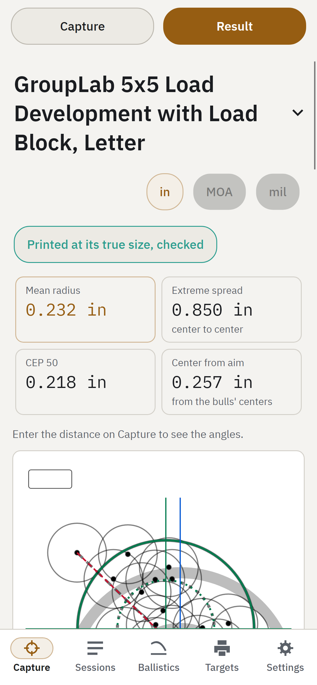

# Statistics for shooters, from the beginning

This page is for anybody who has looked at a group and wondered how good it really is. You do not need any math. Each idea is
explained in words first, with a picture, then what it means at the range, then where GroupLab shows it. Where there is a formula, it
comes last, folded away, and you can skip it without losing the thread.

Every number on this page was worked out by GroupLab's own statistics, the same code that reads your targets.

## How good is this group?

A group is a handful of shots, and the honest question is not how small it looks but what it tells you about the rifle.

This is a real group: 25 shots on a GroupLab sheet, scanned and read by GroupLab, published with its shooter's consent. Most people
look at a group like this and ask one question: how good is it? To answer it you need a few ideas. Where did the shots land on
average? How far do they stray from that? And how much of what you see is the rifle, and how much is luck? The rest of this page takes
those one at a time.

## Where the group is

<!-- figure: centre -->

The center of a group is the average place your shots landed: the point the group is built around.

Take every shot, and find the spot in the middle of them all, the way you would find the balance point of a board with the shots as
weights on it. That spot is the center. It is not the same as the bullseye. If the center sits two inches right of the bull, your rifle
is shooting two inches right, and that is a sight setting, not a skill problem.

**At the range.** The center tells you where to move your sights. The spread around it tells you how good the rifle and the shooter
are. Keep the two apart: a group can be tiny and in the wrong place, or large and centered.

**In GroupLab.** The zero correction reads from the center: how far it is from your aim, in your scope's clicks. See
[the zero correction](USER-GUIDE.md#the-zero-correction) in the user guide.

<!-- math -->
The center is the mean of the shots' across positions and the mean of their up and down positions, taken separately. With shots at
(x1, y1) to (xn, yn), the center is ((x1 + ... + xn) / n, (y1 + ... + yn) / n).
<!-- /math -->

## The biggest gap: extreme spread

<!-- figure: five-more -->

<!-- summary -->
Extreme spread is the distance between the two shots farthest apart, and it changes a lot from one group to the next even when nothing
about the rifle has changed.

Extreme spread is the number most shooters quote. You measure from the outside of one hole to the outside of the farthest hole and
take off one bullet's width. It is easy to measure with a ruler, which is why it is everywhere.

Its weakness is that it uses only two shots. The other shots could be anywhere inside without changing it. And those two shots are
the most extreme ones, so they are the ones luck moves most.

The picture shows six five-shot groups fired by the same imaginary rifle, a rifle that never changes. Press **Shoot five more** to
fire another. Watch the extreme spread jump around: the rifle is the same every time, only luck changes.

**At the range.** One five-shot group with an extreme spread of one inch could come from a rifle that usually shoots three quarters or
one that usually shoots an inch and a half. A single small group is good news, not proof.

**In GroupLab.** Extreme spread is one of the
[six figures in view](USER-GUIDE.md#six-figures-stay-in-view) on the analysis, always with its range beside it.

## The average miss: mean radius

<!-- figure: mean-radius -->

Mean radius is the average distance of every shot from the center of the group.

Measure how far each shot is from the center, add those distances up, and divide by the number of shots. That is the mean radius. It
uses every shot, not just two, so one lucky or unlucky shot moves it less.

For five shots, mean radius and extreme spread are about equally jumpy. The difference shows as you shoot more: mean radius settles
down and extreme spread keeps wandering, because extreme spread only ever looks at the two worst shots. That is why GroupLab leads
with mean radius. There is more in the article
[Mean radius or extreme spread?](https://grouplab.org/research/mean-radius-or-extreme-spread/).

**At the range.** For the same rifle, mean radius is a bit more than a third of the extreme spread of a five-shot group. Compare mean radius
with mean radius, never with somebody's extreme spread.

**In GroupLab.** Mean radius is in the [six figures in view](USER-GUIDE.md#six-figures-stay-in-view), with its range.

<!-- math -->
Mean radius = (r1 + r2 + ... + rn) / n, where each r is a shot's distance from the group's center.
<!-- /math -->

## Angles: MOA and mil

An angle is a group's size divided by its distance, so a group means the same thing at any range.

A group that measures one inch at 100 yards would measure about two inches at 200 yards and three at 300, because the shots spread
out as they travel. So shooters measure groups as angles. One MOA, a minute of angle, is about 1.05 inches at 100 yards, 2.1 at 200 and
so on. One mil, a milliradian, is 3.6 inches at 100 yards, or 10 centimeters at 100 meters.

Use the unit your scope uses, so a group's size and your sight adjustment speak the same language. Every figure on this page is in MOA.

**At the range.** If your scope adjusts in quarter MOA clicks, a group center one MOA right is four clicks left.

**In GroupLab.** Choose the unit once, in [Mil or MOA](USER-GUIDE.md#mil-or-moa); every aiming figure follows it. The article
[MOA, mils and inches](https://grouplab.org/research/moa-mils-inches/) goes further.

## What sigma is

Sigma is the rifle's typical miss: one number for how widely it scatters its shots around the center.

Every rifle scatters its shots a little. If you could fire thousands of shots, the pattern would have a size, and sigma is that size
written as one number. Everything else on this page, mean radius, CEP and the chance of a hit, is sigma times a fixed amount, for a round
group. That is why it is worth knowing: it is the one number the others come from.

You never see sigma directly. GroupLab estimates it from your shots, and the more shots you give it the better the estimate.

**At the range.** For a round group, the mean radius is about one and a quarter times sigma. A rifle with a sigma of 0.4 MOA has a
mean radius of about half an MOA and shoots five-shot groups of about 1.2 MOA, measured as extreme spread.

**In GroupLab.** Sigma is named in the [full figures](USER-GUIDE.md#the-full-cep-table-and-the-fitted-ellipse), and the word is
underlined so you can point at it and read what it means.

<!-- math -->
GroupLab's sigma is the Rayleigh estimate: the square root of the sum of the shots' squared distances from the center, divided by
twice the number of shots less one, with a small correction for bias. For a round group the mean radius is sigma times 1.2533 and the
median distance, CEP 50, is sigma times 1.1774.
<!-- /math -->

## CEP: the circle half your shots land in

<!-- figure: cep -->

CEP 50 is the size of the circle, around the center, that holds half your shots.

Draw a circle around the center of the group, just big enough to hold half the shots. Its radius is CEP 50. CEP 90 is the circle that
holds nine shots in ten. These are easy to picture: a CEP 50 of half an MOA means half your shots land within half an MOA of where the
rifle is pointing.

For a round group, CEP 50 is a little smaller than the mean radius, and CEP 90 is a bit under twice the mean radius. They are the same
spread seen three ways. There is more in [CEP 50 and 90 explained](https://grouplab.org/research/cep-explained/).

**At the range.** If you want nine shots in ten on a target, compare the target's radius with your CEP 90, not your CEP 50.

**In GroupLab.** CEP 50 and 90 are in the [six figures](USER-GUIDE.md#six-figures-stay-in-view); the
[full CEP table](USER-GUIDE.md#the-full-cep-table-and-the-fitted-ellipse) adds 95 and 99.

<!-- math -->
For a round group, CEP for a share q of the shots is sigma times the square root of (minus two times the natural log of (1 minus q)):
1.1774 sigma for half the shots and 2.1460 sigma for nine in ten.
<!-- /math -->

## Why five shots tell you little

<!-- figure: luck -->

<!-- summary -->
A small group is mostly luck: the same rifle shoots groups of very different sizes, and the fewer the shots, the wider the spread.

The picture shows how much a group's size wanders for the same rifle, fired thousands of times. Each bar holds the middle nine groups in
ten. With five shots, the extreme spread runs from about 0.7 MOA to 1.8 MOA: the biggest is more than twice the smallest, from a rifle
that never changed. With twenty shots the range is narrower, and with thirty narrower still. The bars also move right as shots are added: more shots give the extreme spread more chances to grow, so
extreme spreads from different numbers of shots cannot be compared.

So a five-shot group can make a rifle look much better or much worse than it is. That is not a flaw in the rifle or in you. It is
what small numbers do.

**At the range.** Before you believe a change made a difference, shoot enough to be sure. One good group after a change proves very
little.

**In GroupLab.** Every figure carries its range, which is this luck written down. The article
[How many shots do you need?](https://grouplab.org/research/how-many-shots/) shows it for every shot count.

## The range the truth is probably in

<!-- summary -->
A confidence interval is the range your rifle's true figure probably lies in, given the shots you have, and it shrinks as you shoot
more.

GroupLab never gives a figure alone. Next to each one is a range, such as "0.45 MOA, 0.31 to 0.86". It means: from these shots, the
rifle's true mean radius is probably somewhere in that range. "Probably" here means that if you did this many times, the range would
hold the truth 95 times in 100.

How wide the range is depends mostly on how many shots you fired:

| Shots | The true spread is between | and |
| --- | --- | --- |
| 5 | 0.68 times what you measured | 1.92 times |
| 10 | 0.76 times | 1.48 times |
| 20 | 0.82 times | 1.29 times |
| 30 | 0.85 times | 1.22 times |

**At the range.** If two loads' ranges overlap a lot, you do not yet know which is better. Shoot more before you decide.

**In GroupLab.** The range sits beside every figure, and [the "why"](USER-GUIDE.md#what-each-why-says-in-plain-words) behind a
figure says how sure it is.

<!-- math -->
For sigma from n shots, the range comes from the chi-square distribution with 2(n - 1) degrees of freedom: sigma times the square root
of 2(n - 1) divided by its upper and lower 2.5 percent points.
<!-- /math -->

## Comparing two loads

<!-- figure: same-loads -->

<!-- summary -->
When two loads are compared on a few shots, one of them nearly always looks better, even when they are exactly the same.

The picture compares two loads that are truly identical, five shots each, again and again. Press **Compare again**. More than half the
time, one group's extreme spread comes out at least 20 percent smaller than the other's. Shooters write those results down and change
loads because of them.

A statistical test asks a different question: could a difference this big easily come from luck alone? Its answer is a p-value. A
p-value under 0.05 says a difference this large would happen by chance less than one time in twenty if the loads were the same. Here,
with identical loads, the test says "different" about one time in twenty, which is exactly what it promises and no more.

A p-value does not tell you how much better a load is, or the chance that it is better. A large p-value does not prove two loads are
the same; it says these shots cannot tell them apart.

**At the range.** Do not pick a load from one group of each. Shoot both until GroupLab's comparison says it can tell them apart, or
until you accept that the difference, if any, is too small to matter.

**In GroupLab.** [Comparing loads](USER-GUIDE.md#7-comparing-loads) never ranks loads by their figures alone; it says when the data
cannot tell them apart.

## How many shots are enough?

How many shots you need depends on how small a difference you want to see.

To show that one load groups tighter than another, you need this many shots of each. This is for being right four times
in five, the usual standard:

| One load groups tighter by | Shots of each load |
| --- | --- |
| 50 percent | 10 |
| 30 percent | 33 |
| 20 percent | 81 |
| 10 percent | 356 |

Small improvements take a great many shots to prove. That is why it pays to test big changes first and stop chasing tiny ones.

**At the range.** Twenty shots of a load tell you its spread to within about 20 to 30 percent either way. Proving a small
improvement over another load takes far more.

**In GroupLab.** [Shots Needed to Zero](USER-GUIDE.md#shots-needed-to-zero) uses the same thinking for your zero.

## Flyers

A flyer is a shot far from the rest, and in a large group one shot well out is normal, not a mistake.

The more shots you fire, the farther out the worst one will usually be. In a five-shot group from a perfectly steady rifle, the worst
shot is typically about one and two thirds mean radii from the center. In a twenty-shot group it is about two mean radii, and in thirty
a little more. So a shot that sits out on its own is often just the rifle being a rifle.

Calling a shot a flyer and leaving it out makes the group look better than the rifle is. Leave a shot out only when you know why it
went wide: you flinched, the rest moved, or the wind gusted.

**At the range.** Note why a shot went wide while you remember. Without a reason, keep it.

**In GroupLab.** [Click a hole](USER-GUIDE.md#click-a-hole-to-edit-it) to call it a flyer, with your reason; the
[Worst shot](USER-GUIDE.md#the-two-cards) card says whether it is farther out than chance would put it.

## Velocity spread and the vertical

The spread in your muzzle velocity, its standard deviation or SD, shows up on paper as up and down spread, and more so the farther the target.

No two cartridges leave the barrel at exactly the same speed. A slower bullet drops a little more on its way to the target, a faster
one a little less. At 100 yards the difference is small. At long range it can be the largest part of your up and down spread, so a
load with a small velocity SD matters more the farther you shoot.

An SD from a few readings is as much at the mercy of luck as a group from a few shots, so it needs its range beside it too.

**At the range.** If your groups are taller than they are wide at distance, look at your velocity SD before you blame yourself.

**In GroupLab.** [Velocity and the vertical](USER-GUIDE.md#velocity-and-the-vertical) shows how much of a group's height your
velocity spread explains.

## Hit probability on a real target

The chance of a hit is the share of shots that would land on a target of a given size at a given distance, worked out from your
group.

This is the most useful number on this page, because it answers the question you actually care about: will I hit it? The table shows
the chance of a hit on circles of 4 and 8 inches, from precision alone: a perfect zero, no wind and the right range. Real shooting
adds those errors, so real chances are lower.

| Typical miss (sigma) | 100 yards, 4 in | 300 yards, 4 in | 300 yards, 8 in | 500 yards, 8 in | 800 yards, 8 in |
| --- | --- | --- | --- | --- | --- |
| 0.25 MOA | over 99.9 % | 96 % | over 99.9 % | 99 % | 84 % |
| 0.5 MOA | 99.9 % | 56 % | 96 % | 69 % | 37 % |
| 1 MOA | 84 % | 18 % | 56 % | 25 % | 11 % |

**At the range.** Decide the size of your target and your distance first, then see what precision you need. That tells you whether a
better group is worth chasing.

**In GroupLab.** [Hit probability](USER-GUIDE.md#hit-probability) works this out from your own group, for a circle, a rectangle or an
IPSC outline, and adds a wind call and range error if you give them.

<!-- math -->
For a round group with no aiming error, the chance that a shot lands within radius r of the aim is 1 minus e raised to the power minus
r squared over twice sigma squared, with sigma and r in the same units at the target.
<!-- /math -->

## What is good enough?

<!-- summary -->
Good is set by your job, not by bragging: work out the target size and distance, and ask what precision gives you the hits you need.

A half-MOA rifle is wonderful. But say your job is an eight-inch target at 300 yards. A rifle with a sigma of half an MOA already hits
it 96 times in 100, from precision alone. At that distance, wind and range will cost you more than the last quarter MOA of the rifle.
At 800 yards, the same rifle hits that target about one time in three, and precision matters a great deal.

So decide what you want to hit, at what distance, and how often. Use the table above, or GroupLab's own hit probability for your
group. That gives you a goal you can measure, and tells you when to stop.

This page does not give typical figures for factory, match or benchrest rifles, or typical velocity SDs. Such numbers are often
quoted. But we found no measured source for them that we can stand behind, and a figure without a source is a story.

## Reading somebody else's claim

When somebody says "a half-MOA rifle", ask how many groups, how many shots each, and which figure.

A claim of half an MOA can mean very different things:

- **One group or many?** The best of several groups is much smaller than a typical one.
- **How many shots?** A three-shot group is far smaller, on average, than a ten-shot group from the same rifle.
- **Which figure?** Extreme spread, mean radius and CEP are different sizes for the same group. Half an MOA mean radius is a much
  better rifle than half an MOA extreme spread.

A fair claim names all three, such as "an average of 0.9 MOA extreme spread over five ten-shot groups". Anything less is a hint, not a
measurement.

## What no number can tell you

A small group from five shots is a hint, not a verdict, and some things no number of shots will tell you.

Statistics tell you how sure you can be about the shots you fired. They cannot tell you about conditions you did not shoot in: another
day's heat, another lot of powder, a dirtier barrel, a tired shooter. A group shot on one day measures that day.

They also assume each shot is like the others. If the barrel heats and the group walks, or you change position halfway through, the
numbers describe a mixture. GroupLab checks for some of this, such as whether a group opened up as it was shot. But it cannot know what
it was not shown.

Use the numbers to decide when you know enough, and keep shooting when you do not.

## Where to go next

- [Mean radius or extreme spread?](https://grouplab.org/research/mean-radius-or-extreme-spread/)
- [CEP 50 and 90 explained](https://grouplab.org/research/cep-explained/)
- [How many shots do you need?](https://grouplab.org/research/how-many-shots/)
- [MOA, mils and inches](https://grouplab.org/research/moa-mils-inches/)
- [Pooling several groups into one](https://grouplab.org/research/pooling-groups/)
- The [glossary](https://grouplab.org/guides/glossary/), with every word GroupLab uses.
