# GroupLab user guide

GroupLab measures how accurately a rifle shoots, and tells you how much its figures can be trusted. It works on any target you already shoot: photograph or scan it, set the scale once and mark the holes by hand (section 1, under a target GroupLab did not print, says how). A GroupLab sheet is the fast lane, where the scale and every hole are found by themselves, and this guide takes one from the printer to the analysis. It describes the Windows application as it is built today, and every picture in it is a render of the build.

The rail down the left of the window is how you move around it:
- the mark at the top is the sheet you are working on;
- then Targets, where sheets are chosen and printed, the session records and the ballistics screen;
- then load comparison;
- the gear at the foot is the settings.

If you are new, **Walk me through a demo** in Settings takes you through GroupLab on a sample sheet it makes itself, in about five minutes.

## Mil or MOA

GroupLab works in your scope's unit, mil or MOA, and neither is the default. The first time it starts, on the computer and on the phone,
it asks **Is your scope in mil (1) or MOA (2)?**, with a third answer, **Both, I have rifles of each** (3), and whether you measure sizes on the paper
in inches or millimeters. Your answer becomes the **Scope unit** at the top of Units in Settings, where you can change it at any time.

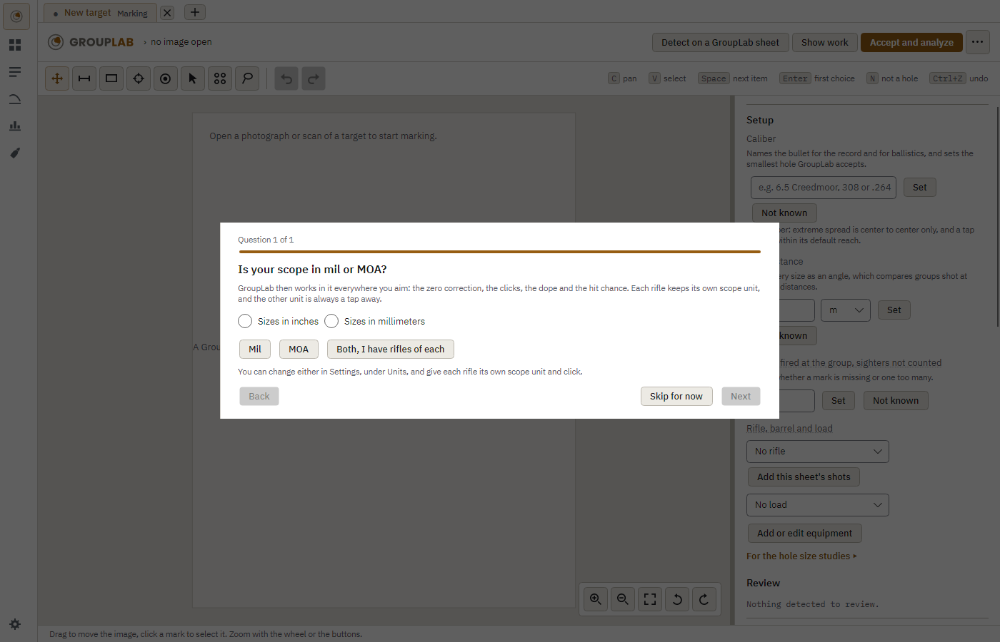
<!-- marks: Mil | MOA | Both, I have rifles of each -->

### Each rifle keeps its own

A rifle's record has its scope unit (1) and one click (2): 0.1 mil, 0.05 mil, 1/4 MOA, 1/8 MOA, or any other
value you type. When a session names a rifle, that rifle's unit wins over Settings; when it names none, Settings decides. If you answered
Both, a session with no rifle asks which rifle it was.

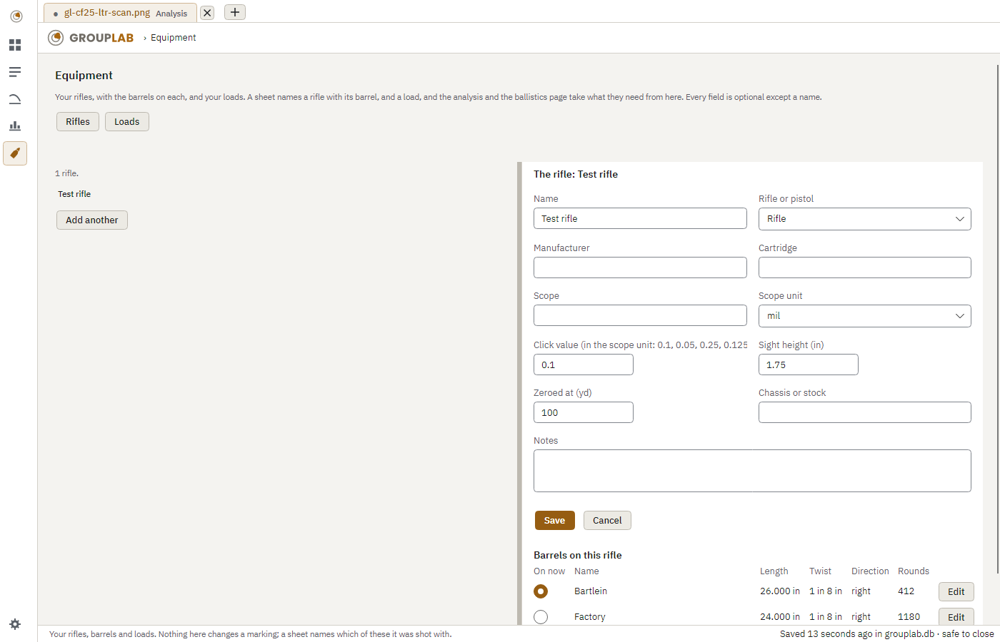
<!-- marks: EquipmentField_clickUnit | EquipmentField_clickValue -->

### Everything aiming follows it

Everything aiming follows it: the zero correction, the clicks, Shots Needed to Zero, the dope table, the hit chance, the table of
each shot's offset, Zero from this group, and group sizes shown as angles. With a mil scope the zero correction reads in mil alone,
such as "dial 0.30 mil left, 3 clicks left", with no MOA next to it. The other unit is never far: tap a number to
switch it, or press and hold it for every unit it can take, and GroupLab remembers that figure's choice.

### Scope and mount

The rifle's page in Equipment has a **Scope and mount** part. Every field in it is optional, and on the phone the same fields are in Ballistics, under Rifle. These three began as calculators GroupLab's developer wrote before GroupLab: scope cant (here rail cant), sight scale factor and Top Gun. Top Gun is Bryan Litz's.

**The fields:**
- **Elevation travel**, in your scope's unit, with **That travel is** the total travel, or the most up from my zero.
- **Rail cant**, in your scope's unit: how much the rail the scope sits on slopes down toward the target, from the factory or from shimming. (Alan's page calls it scope cant. GroupLab says rail cant because cant on its own usually means tilting the rifle.)
- **Sight scale factor**, 1.000 when the scope tracks true.
- **Weight as fired**, with the optic, the loaded magazine and the bipod, in pounds.

**What the scope and mount allow.** Under the form GroupLab works this out with the load it can use. It shows the elevation your zero uses, half the travel, and the most rail cant that still lets the rifle be zeroed. With your rail's cant entered it shows the elevation left above your zero and the farthest range that elevation reaches with that load. When the rail's cant is more than the most that zeroes, it says the rifle cannot be zeroed with it.

The elevation the zero uses is GroupLab's own: the angle its solver gives the bore, which counts the bullet slowing down. Alan's page adds the sight-height angle to a drop worked out as if the bullet flew at one speed. That is the one deliberate difference. For a 140 gr bullet at 2710 ft/s with a G7 ballistic coefficient of 0.326, a 1.75 in sight height and a 100 yd zero, his page's way gives 4.05 MOA and GroupLab's gives 4.01 MOA.

**Ballistics follows it.** Past the last range the elevation left reaches, the Trajectory table's clicks column says "out of elevation, hold X mil in the reticle" (or MOA), the At one range panel says the same, and the Point blank view says when its zero needs more elevation than the scope has above your present zero. The phone's dope table does too.

**Sight scale factor.** A scope's turret does not always move the reticle by what it is marked. **Work out the sight scale factor from a tracking test** takes the unit, the angle you expected (20.0 mil or 66.0 MOA to start, the lines of a tall tracking target) and the turret reading, and gives the factor, the expected angle divided by the reading. The error is the reading minus the expected, over the expected, as a percent; positive means the scope under-tracks, each click moving less than marked. Under 0.5 percent is essentially perfect, under 2 percent is normal for a quality scope, and 2 percent or more is a significant tracking error. The steps: level the reticle, measure the distance to the target, then dial from the top line to the bottom line and read the turret.

Every click GroupLab gives is corrected by the factor, the turret reading being the true angle divided by it: the Trajectory table, At one range, the analysis's zero corrections, Shots Needed to Zero, the Point blank view and its card, and the phone. Where the factor is not 1.000 the clicks say so once, for example "SSF 0.980 applied".

**Top Gun.** Bryan Litz's trend (Modern Advancements in Long Range Shooting, Volume III, chapter 3, 2022) puts the expected average group, in MOA, at the muzzle energy in foot pounds divided by the rifle's weight as fired in pounds, divided by 200. Muzzle energy is the bullet's weight in grains times the velocity squared, divided by 450240. A 140 gr bullet at 2710 ft/s from an 11 lb rifle comes to about 1.04 MOA. GroupLab shows it as Litz states it, "Top Gun expects about 1.04 MOA average group for this rifle and load (Bryan Litz's trend, not a limit).", on the rifle's page for each of its loads, in the analysis's Advanced figures where the rifle and load are known, and in Compare loads for each load. It is a trend with real rifles scattered on both sides, so it is never a pass or a fail. It is not converted or set beside GroupLab's own figures yet, because how many shots its group is, and whether it is extreme spread, is still being checked.

### Getting GroupLab

The download page, grouplab.org/download/, has every build. On Windows, the Microsoft Store carries GroupLab too
and gets every nightly once Microsoft has certified it, usually a day or so later, and updates itself ([Get it from
Microsoft](https://apps.microsoft.com/detail/9NWJCXBKZNPZ)); the installer and the zip there are the newest test build the moment it is made. On an iPhone or iPad, GroupLab is in a public beta through Apple's TestFlight: install TestFlight from
the App Store, then open [the invitation](https://testflight.apple.com/join/A3xyT6C6) on the device.

## 1. Print a sheet

Open **Targets** from the rail. It lists the built-in sheets by family, read only, and your own sheets after them. Choose a sheet and
everything it takes to print it is beside the list, with the page filling the rest of the screen. The page is drawn live from the same
shapes and letters as its PDF, so it is exactly what prints, changes the moment any setting or designer field does, and stays sharp at any
zoom on any screen; **Open as PDF** (1) under it opens the real PDF in your viewer. The phone's Targets screen draws its page the same way.

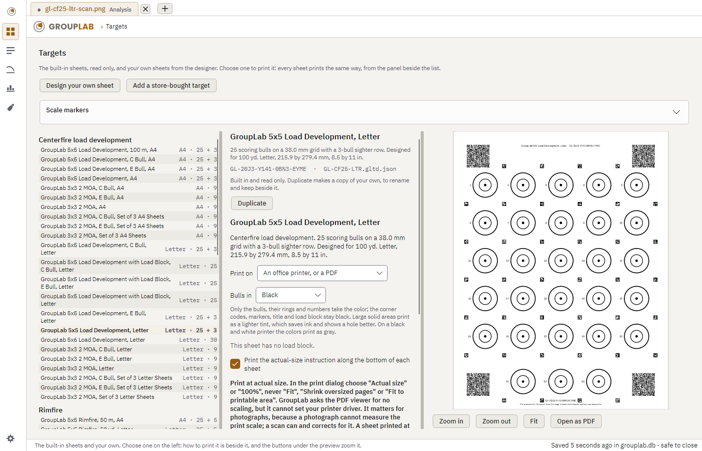
<!-- marks: Open as PDF | Bulls in -->

- **Bulls in** (2) black, blue or red, for any sheet, built in or your own, on the computer and the phone. Only the bulls, their rings and numbers take the color; the corner codes, markers, title and load block stay black. Lines print in the full color and large solid areas, such as the C bull's diamond, as a lighter tint, so a hole shows dark against it. The preview and the PDF follow the choice at once, and GroupLab remembers it for that sheet. GroupLab finds the color from the photograph, so nothing needs to be set when you read the sheet. On a black and white printer the colors print as gray. On a color inkjet, filled bulls use less ink in color than in black, while ring bulls and zeroing grids use a little more, since a colored line takes two inks; blue uses a little less than red.
- **The load block** can be left blank, to write in at the range, or filled in now from the fields shown. On a sheet with room for it, a filled block also carries an instance code, so GroupLab reads the load straight off the sheet.
- **Print** (on Windows) prints from inside GroupLab at actual size. It refuses, with the reason, when the paper is not the sheet's or ink would fall in the printer's margin. When the job is sent, a confirmation names the printer and the pages.
- **Open to print** opens the PDF in your viewer instead. Print it from there at Actual size or 100 percent, never Fit.
- **Save PDF** keeps the file.

### Three sheets come with the E bull as well

Three sheets come with the E bull as well: the 5x5 load development sheets for Letter, Letter with the load block, and A4, each with every
bull a black disc with a 0.36 in white center and a small dot. The aim point test of 2026-09-26 found it could be centered on through
every high power scope at 10x, where the usual bull could not. They sit beside the usual ones in the list, with their own identifiers.

### And three with the C bull

And three with the C bull: the same three sheets with every bull a black diamond standing on a point, 1.25 in point to point, with a
white diamond center and a small dot. Its points lie on the vertical and horizontal lines through the aim, so a crosshair lines up with the
shape. **Design your own sheet** offers the rings, E or C for its bull, and **Made for your optic** a disc or a diamond, sized by the same
rule. None of them replaces the usual bull.

### The large format sheets print on Letter or A4

Each is a set of four sheets with eight 1.5 in or 1.4 in bulls apiece, the same bulls
and spacing the tabloid and A3 sheets had; each sheet has its own markers and codes, so scan or photograph them one at a time. A tabloid or
A3 sheet you printed before still reads. The roll sheets are for a plotter, and a photograph of a whole one needs a phone of about 50 MP.

### Label targets are for a thermal label printer

Each 4x6, A6 or 100 by 150 mm label holds six bulls the size of the Letter sheets', in a set of five labels that pool into one group like the 300 yard tiles; a printer check label measures a label printer on its own paper, across and along the feed. Choose a thermal printer under **Print on** and GroupLab draws the page one dot at a time in black only, with every code and marker on whole dots, shows every dot in the preview, and names anything a narrow printer would cut off before you print. Thermal paper darkens in heat and fades in sunlight, so photograph a thermal target the day you shoot it. For a label printer GroupLab does not print to itself, **Save for a printer app…** on the computer, or **Share for a printer app** on the phone, hands the sheet to the printer's own app as a black and white picture at 300 dpi and a PDF, both at the page's true size; print them at 100 percent or actual size, never fit to page. The **darkness test page** beside it shows what each darkness setting in the app does to fine lines. No label printer has printed GroupLab's check page yet, so until one has, label printing should work but is not proven. On Windows, with **Phomemo M834** chosen under **Print on** and the printer paired in Windows Settings (Bluetooth and devices, Add device), **Print on the Phomemo M834** sends the sheet straight to it over Bluetooth, the same page the phone sends, with **A continuous roll** or **Fanfold sheets** chosen as on the phone; it has not yet been tried on a real M834 from a computer. Close the Phomemo app on the phone while the computer prints, since the printer takes one connection at a time. On macOS and Linux the choice says it is not available there yet.

### The zeroing grids are for sighting in by eye

Each prints at exact scale, so at the bench you fire, read the correction off the grid, dial it and fire again. The squares are a scope's own: 0.2 mil or 0.5 MOA, with a small tick at every click (0.1 mil or 1/4 MOA) between the lines along the center cross and the frame. The legend above the grid, large enough to read through the scope, says what a square and a tick are; each line's distance from the aim is written outside the grid, and nothing on it. Aim at the diamond. A 4 in or 10 cm bar at the bottom checks the print: measure it before you shoot. The sheet has no load block, so enter the load on the session. The design, C3, was chosen by Alan with Jylee and Unholy. For a zero worked out from a group, and the group figures, shoot a [5x5 sheet](#2-shoot-it) instead. GroupLab still reads a scanned zeroing grid, but it cannot know the order of the shots or the dialing between them, which is what the grid was for.

### Made for your optic

Under Design your own sheet, give the distance, the lowest magnification you will shoot at (1 for a red dot, with the dot's size in MOA) and the number of shots, and press Make the sheet. GroupLab sizes a bull you can center on through that optic: a black disc with a white center that subtends about 3.5 arcminutes at that magnification, the size the aim point test found people can center on, with nothing small at the middle for a crosshair to cover. It makes as many sheets as the shots need, and each sheet's codes say which of the set it is. Analyze each sheet by itself for now; putting a set together into one group is still to come.

### Several bulls on any target

A target GroupLab did not print, with several bulls (suggested by Unholy, also TNA). Choose **Place bulls** (B) and tap each bull's aim point; drag one to move it, and Delete takes the chosen one away. Shots go to their nearest bull and are drawn in its color, so a shot on the wrong bull shows. **Lasso** (O): draw round several shots, then tap the bull they belong to. For the scale, tap four corners of something rectangular whose size you know, such as the paper's edge, which removes the photograph's angle; or draw a length near a bull, a ring's width or a grid square, and choose **Use it as bull N's own scale**, then a second at right angles to it. GroupLab says when the bulls' scales disagree, which means the photograph was taken at an angle, and how uncertain the sizes are because of it. Under Advanced, **Bull by bull** gives each bull as its own group beside the pooled one. With the bulls tool in hand, **Save these bulls** keeps them as a template; on the next sheet of the same target, tap its first two bulls and **Place the rest**.

### Store-bought targets

<!--count:store-targets:Words-->Nine<!--/count--> store-bought targets, from Birchwood Casey and the National Target Company, are recognized on the computer and the phone: GroupLab names the target, places its bulls and takes the scale from its printed size, within a median of 0.06 percent for the five made from 600 dpi scans and to within about 0.6 to 0.75 percent for those made from phone photographs, warns that printed targets can vary with Check the scale one click away, and asks which you have when the 6 in and 8 in Shoot-N-C bullseyes look alike. The list grows as targets are added to it, and a target added after your build reaches it without a new build: GroupLab looks for a newer signed list when it starts (on a phone, only on Wi-Fi with the battery and storage not low, at most every six hours) and uses it only when its signature checks. There is no way to send one in yet.

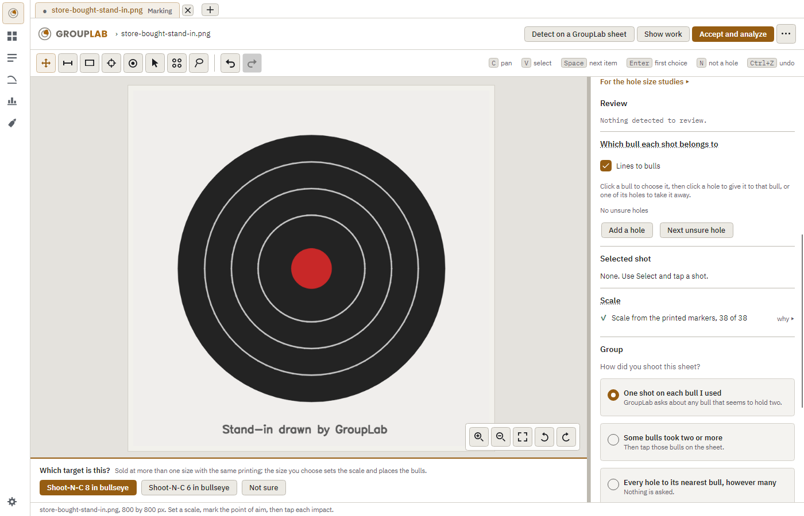

### Scale markers

Put one of these beside a target GroupLab did not print and it takes the scale from the photo, with nothing typed or tapped. Targets, Scale markers prints them at actual size on Letter or A4: **corner brackets** (1), four L shaped pieces cut roughly from one page, one placed flat near each corner of the target, anywhere close: their printed codes give the scale and the camera's angle, so the cut does not need to be neat, and GroupLab finds the target's corners from its own edges where they show against the surface; **scale bars** (2), two strips with a code at each end 10.000 in apart (250 mm on A4), one laid along an edge for the scale, two in an L for the angle too, or two end to end for a poster; and **board stickers** (3), four codes stuck near the corners of your target board and measured once (Measure a board, with any GroupLab sheet on the board), after which every photo of a target on that board has its scale with nothing placed. **Scale labels**, for a label printer such as the Phomemo M220, are rows of codes across a label of the size loaded, stuck flat on the target where you will not shoot; they are read across only, because a label printer's paper feed is not exact. **Save the printer check label** gives one label to print at 100 percent and scan at 600 dpi, and **Measure a scanned check label** measures the printer across its head and along its feed and keeps the result with the label size, so every later label is laid out for that size. On Android, **Print two scale labels on the Phomemo M220** sends two labels of the size loaded straight to the printer over Bluetooth, with no Phomemo app; on Android 10 and 11 pair the printer in Bluetooth settings first. A **bank card**, driver's license or gift card laid back side up beside the target needs nothing printed: GroupLab blanks the card out of the photo at once, never keeps, shows in a saved picture, logs or sends that part of it, and never reads anything on a card. Markers count in Add a store-bought target (Markers in the photo, chosen by itself when they are found) and when you mark a target by hand. On computer-made photos a measured board was typically within 0.015 percent, a scale bar 0.06, corner brackets 0.07 on a 12 in target and 0.2 on a 23 by 35 in poster, and a card 0.15. Printed markers are corrected by your printer check, and without one can be off by up to 1.5 percent. Every piece has to lie flat on the same surface as the target. Brackets must touch the target's corners: a gap of 2 mm makes a 12 in target read about 2 percent large, though the scale is still right. A bar can touch the target or lie a little apart; the scale is the same either way. A board that swells evenly cannot be told from one that has not, so measure it again now and then and whenever it gets wet; a board whose stickers have moved, GroupLab notices and asks you to measure again.

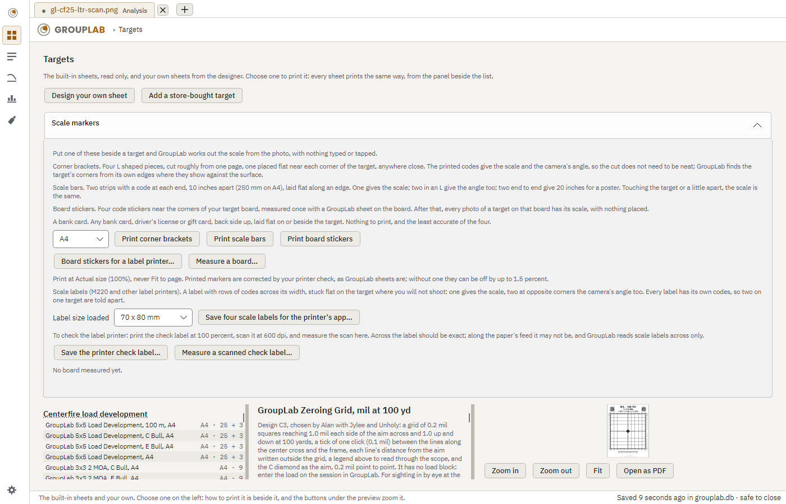
<!-- marks: Print corner brackets | Print scale bars | Print board stickers -->

### Add a store-bought target

On Targets, **Add a store-bought target** teaches GroupLab one it does not know, from a photograph of a blank one, in five steps, one question at a time: **Photo**, **Size and scale**, **Straighten**, **The bulls** and **Name and send**. On the computer the steps (1) are listed on the left, done ones ticked in teal and the current one amber, the photo in the middle and the question on the right with **Back** and **Next** (2); on the phone each step fills the screen, with a five-part bar and Back at the top and one big button at the bottom. Choose or take a photo of the target flat and square on, all four corners in it. GroupLab shows it the way up it was taken, and **Rotate left** and **Rotate right** (R and Shift R on the computer) turn it a quarter turn for a target photographed sideways. It finds the corners from the paper's edges and color, so white paper on a light counter works; where it cannot, it says why and starts four amber handles at its best guess for you to drag. Scroll or pinch to zoom in; while you drag a corner, a magnifier above it shows the point under your finger, and a corner let go lands on the clear corner of the picture nearest it, with **Undo**. **How big is this target?** takes one true length three ways: **Its printed size** (3), the width and height on the package; **A GroupLab sheet in the photo**, laid on the target; or **Two points and a distance**, both ends of something you measured and its length. Under the one picked is what GroupLab measured for it on computer-made photos of two test posters, typically within 0.01 percent at 12 by 18 in and 0.28 percent at 23 by 35 in from the printed size, 0.16 and 0.40 percent from two points, and a Letter sheet too small to read at all on the larger poster; no way is called the best, because none was at every size. **Straighten** shows the corners to check; **The bulls** shows the target straightened with each bull it found as a numbered ring: tap or click a ring to remove it, or the picture to add one, and **These are right** moves on. Last, type the name on its package: where it matches a target already in GroupLab's library at another size, GroupLab says it joins that family; at the same size, that GroupLab already knows it. **Save reference file** on the computer, or **Save and share the file** on the phone, writes the file: the fingerprint, name, size and bulls, never the photo. Send it to GroupLab's maker; each file is checked by hand before it joins the library a later GroupLab recognizes.

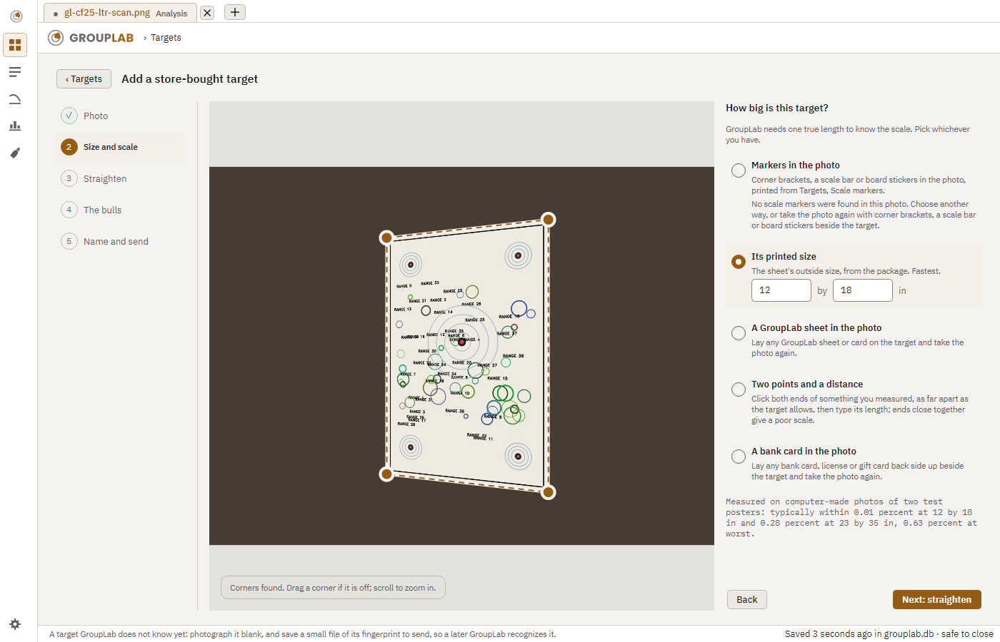
<!-- marks: Steps | Next: straighten | Its printed size -->

### Find holes (Experimental)

Once the scale is set, and the bulls if you placed them, the button under the scale proposes the holes: a hole darker than the paper, a hole in a black bull where what shows through is lighter than the ink, and on a fluorescent target a dark center inside its bright ring. Each one is a mark like any other, to keep, drag onto its hole or delete, and one GroupLab is not sure of is in the review with the reason. It is experimental: it misses some holes, such as one on the edge of a black bull, and it can take printing for a hole, so look at every mark before you trust the figures. Undo takes all of them back at once, and pressing it again replaces only the marks you have not touched.

### Large targets

A sheet larger than Letter or A4 does not fit a flatbed scanner. For each one the Targets screen works out how many pixels an inch a phone photograph of the whole sheet gives and says whether that is enough. Tiled Letter or A4 pages are the better choice for a large target: each page scans by itself, and a plotter can print them all on one large page with cut lines between them.

### Check the size before you shoot

Measure from the center of bull 1 to the center of bull 5 with a ruler. On the Letter 5x5 sheet it is 5.98 in (152.0 mm). If it is not, the printer scaled the sheet, and it should be printed again.

### Your own sheet

Design your own sheet, at the top of Targets, lays out a grid of bulls:
- you choose the page, the rows and columns, the spacing, the ring, the sighters and a load block;
- the bull's size can also be given in inches, MOA or mil, the angles read at the distance you give, so a 0.25 mil bull is 0.90 in across at 100 yd; the E and C bulls take the size exactly, and the rings take the nearest ring set;
- the bull's size can be given in inches, MOA or mil, the angles at the distance you give, so a 0.25 mil bull is 0.90 in across at 100 yd; the E and C bulls take the size exactly and the rings take the nearest ring set;
- a layout that cannot register or fit is refused;
- if you give your five-shot group, a spacing tight for it is warned about.

Save to your own sheets keeps a design in the list. There you can rename it, duplicate it, or delete it after GroupLab asks. Duplicate works on a built-in sheet too, as the start of one of your own. Deleting a sheet never makes a session unreadable, because every session keeps its own copy of the sheet it was analyzed against.

### A volunteer pack

Print a volunteer pack, beside the chosen sheet, gives the sheet and one page of instructions together, for someone shooting a sheet for the project.

## 2. Shoot it

- Mount the sheet flat, supported all over.
- For a load development sheet, fire one shot per bull, in order, starting at bull 1. The sighter bulls are for sighters, and GroupLab keeps them out of the group unless you ask for them to be analyzed.
- Write only in the load block.

GroupLab matches the holes to the bulls as one sheet, not hole by hole: with a rifle that is not yet zeroed, most holes sit nearer the bull below or beside the one aimed at, and it still gives each to the bull it was fired at, reading the sheet in the order it is shot, from bull 1. Where the holes fit two sets of bulls equally well, it asks which bulls you fired at, in the middle of the screen, with its own guess first. Each shot is named by its bull, Bull 7, or Bull 7, shot 2 where a bull holds more than one, and a thin line runs from every hole to the bull it was given, on the analysis and in Fix holes. **Lines to bulls** (1) in the side panel's block, Which bull each shot belongs to, switches them off, and the choice is remembered. A line worth a second look is dashed in orange with a **?** beside the hole: GroupLab was not sure, or the line is long for the sheet, or it crosses into a neighboring bull. **Next unsure hole** (2) goes to the next one. To move holes, click a bull to choose it (a blue ring, its lines blue, the others dimmed), then click a hole to give it to that bull, or click one of its holes to take it away; the block says, for example, "C3 has 2 shots". **Done** (3), Escape or clicking the bull again ends it.

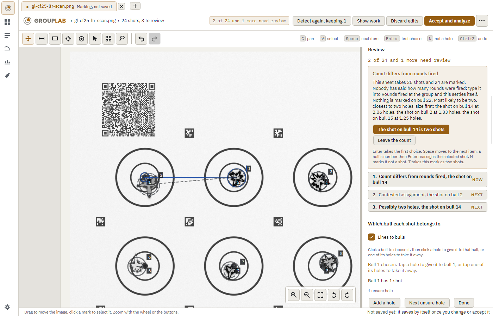
<!-- marks: Lines to bulls | Next unsure hole | Done -->

Some sheets break one shot a bull on purpose, such as two shots into each of bulls 1 to 10. Say so before you accept the marking, in the side panel's Groups section, under **How did you shoot this sheet?**: **One shot on each bull I used**, **Some bulls took two or more** (then tap those bulls), or **Every hole to its nearest bull, however many**. Bulls left blank are found by themselves, and a line says how many ("N bulls unused. Wrong? Tap them.") with buttons to tap the bulls that took two or the bulls you fired at. Under them, **Loads on this sheet** sets **One load**, **One a row**, **One a column** or **I will pick bulls** (shift-click the bulls, then choose a load), and the sheet shows each row's or column's load beside it. A line reads it back, for example "GroupLab will read it as: 23 bulls fired at, one shot each, rows 1 to 5 as Load A to Load E."

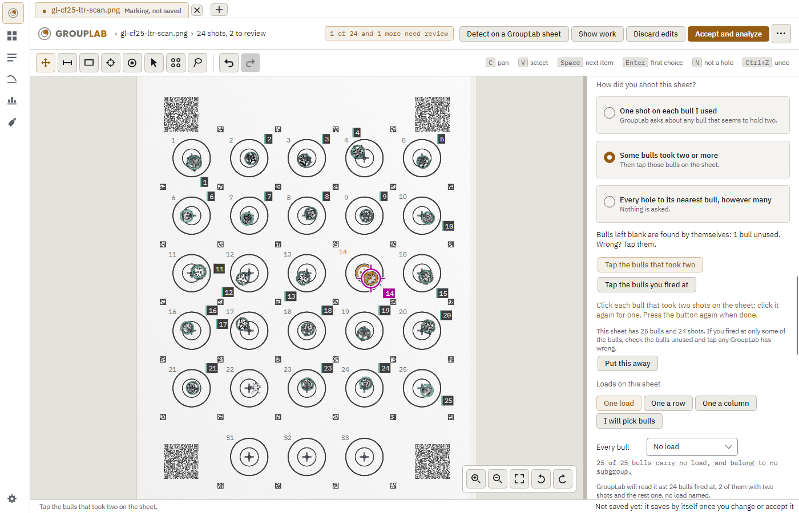

A sheet with one scoring bull takes a group. Every shot on it goes to that bull, however far out, and the review asks nothing about how many there are; say how many you fired, in Rounds fired, and a count that disagrees names the mark most likely to hold two.

## 3. Photograph or scan it

### A flat scan at 600 dpi is the best record of a sheet

GroupLab reads the resolution your scanner wrote into the file and uses it as a starting point, then measures the real resolution from the sheet's own printed markers and tells you both. Where the two disagree, the markers win, because they were printed at a known size and the file's number is only what the scanner meant to do.

For photographs:
- stand about 2 ft (60 cm) from the sheet, close enough that the sheet nearly fills the frame;
- use the phone's main camera, not its wide or zoom lens;
- keep the whole sheet and all its corner squares in the frame;
- do not crop the pictures, and do not send them through a messaging app, which shrinks them.

### Flat on a table, or straight on at the backer

The phone's camera works either way. Lay the sheet flat and hold the phone over it,
or leave the sheet on its backer at the range and hold the phone upright, straight on to it, in portrait or landscape. The word under the
camera's level says which, **Looking down** or **Upright**, and the level turns green in either when the camera is square to the sheet.
Once the sheet's corner squares are read, the sheet's own angle decides, so a backer leaning back, or a table that is not level, is still
square when the phone is square to the sheet. Guided takes the picture by itself in either position under the same rules: square to the
sheet within 37 degrees, steady, and the sheet read.

### Real inches from a photograph

A photograph has no ruler in it, so on its own it measures in the sheet's own inches: a sheet your
printer printed at 97 percent makes every group read about 3 percent large. For real inches from a photograph, scan one sheet or measure one ruler distance, once per printer; GroupLab remembers it.
The easiest way is the printer check, offered the first time GroupLab opens and the first time you print, and always in Settings under
**Printers**. Name the printer, print the check page at actual size, and measure it one way: lay any bank, gift or ID card inside its
outline and take one photo (about 0.3 percent), measure between its crosshairs with a digital caliper (about 0.1 percent), measure its
two long lines with a ruler or tape, or scan it. GroupLab shows how large the printer prints across and down and saves it. Photographs of
that printer's sheets are then corrected, and each result says so in one line, such as "Corrected for My printer, 99.2 by 99.4%, checked
28 September". A check measures the sheets printed before it. If you calibrate or service the printer, or change its settings, press
**Printer calibrated or serviced** under that printer in Settings: sheets printed before stay corrected by the old check, and every result
it corrects says so and offers **Check your printer** (1) again, which is worth doing on a sheet printed now. GroupLab offers the same after
about six months. The paper's own edge is checked on every photo too: GroupLab says when it disagrees with the printer's figures by more than about 1.5 percent,
or when a sheet looks printed with Fit to page. On any one photograph, **Measure this sheet with a ruler** (2) corrects just that sheet.

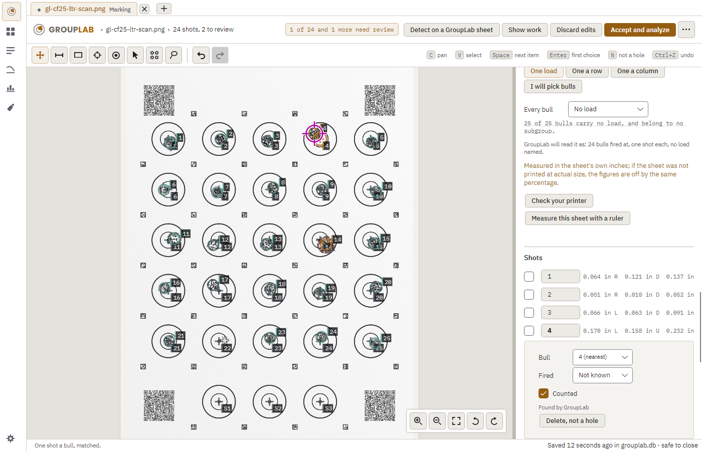
<!-- marks: Check your printer | Measure this sheet with a ruler -->

## 4. Mark it and settle the review queue

Open image, in the header's menu, opens a scan or a photograph. On a GroupLab sheet the rest happens on its own:
1. GroupLab reads the sheet's printed codes to name its definition.
2. It registers the page from the corner and edge markers.
3. It finds the holes by comparing the image with the sheet as printed.
4. It gives each hole to a bull.

### Several targets open at once

On the computer, each target has its own tab across the top of the window: its name, **Analysis** or
**Marking**, with **not saved** while it has marks that are not saved, and a dot, amber when not saved. The **+** tab opens another target
the way Open image does, and **Ctrl+Tab** goes to the next tab (**Ctrl+Shift+Tab** the one before). Each tab keeps its own target, zoom,
marks and undo, so switching never loses or mixes anything. A tab's **×** closes it, and asks first when it has marks that are not saved. When there are more tabs than fit, a thin bar in a row of its own under them scrolls the row, and the tab you
choose or open is always brought fully into view.

### When a picture names no sheet

A picture of a target GroupLab did not print is not a mistake: GroupLab asks **Which target is this?**
in the middle of the window, with **Mark it by hand** (1) first (one true length: the sheet's size, a ring, or a ruler in the picture),
**It is a store-bought target** (2), and **It is a GroupLab sheet** (3). A picture that has a GroupLab sheet's corner squares or codes, but whose
codes would not read, says so in the middle of the window instead: the picture with its corner codes outlined, what got done and what did
not, and **Choose the sheet** first, then **Try again, reading harder** and **Mark it by hand**; under a line, **Not a GroupLab sheet?**
for a store-bought or hand-drawn target, which GroupLab remembers for that picture; and **Show what went wrong**. **Try again, reading
harder** reads the picture at full size, then each corner code on its own, lit evenly and turned square on, then looks for the sheet's
printed name, naming each step in the status line with Cancel beside it; it takes a minute or two, and is offered once a picture. A sheet it
names is measured at once; if it names none, the window comes back saying so. Dismissed with Escape or its ×, it leaves an amber bar
under the header with **Choose the sheet** and **All choices**, and Show work says **codes not read**. Any other problem that stops the
work on the computer, such as a picture or a file that could not be opened, a save, export, send or print that failed, or Find holes
without a scale, opens the same kind of window with what to do next; what needs no decision, such as saved or sent, stays in the status
line. In any such window Enter takes the first choice and Escape closes it.

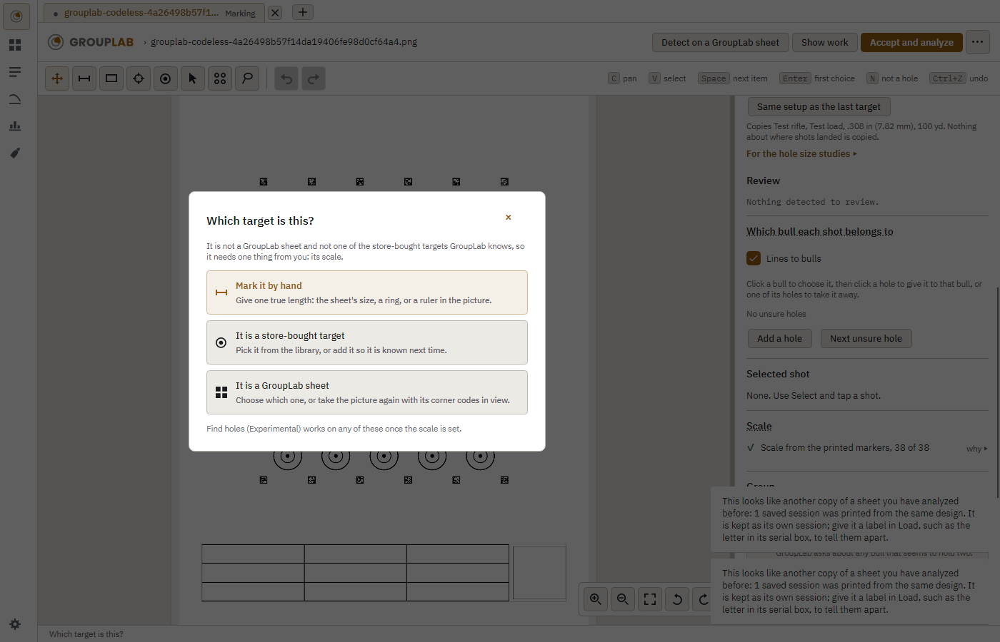
<!-- marks: Mark it by hand | It is a store-bought target | It is a GroupLab sheet -->

Every result is an ordinary mark that you can move, delete or reassign. On any other target, you mark the holes by hand against a length or a rectangle of known size. To change that scale, tap its two ends or four corners again and enter the new size, or choose the length or rectangle tool and **Change the length of the scale in use**; every figure follows. Typing a caliber offers the calibers and cartridges that match, with spacing and points forgiven, so "65 creed" finds 6.5 Creedmoor, and choosing one from the list, with a click or with Enter, sets it at once. **Caliber box shows** in Settings, the same on the phone, chooses what the list offers: **Calibers**, the bullet diameters with their usual names, such as .308 (7.62 mm, .30); **Cartridges**, the names, each with its diameter, such as 6.5 Creedmoor, 0.264 in; or **Both**, calibers first and then cartridges, which is where it starts. Any other diameter can still be typed in inches or in millimeters.

With the rectangle tool, **Find the paper's edges** places the four corners on the paper itself when the sheet stands out from what is
behind it, still draggable, and offers a standard paper size when the photograph's shape matches one. On a white board it cannot tell the
paper from the board, and you tap the corners. A photograph taken more than 37 degrees off square to the sheet is refused, with the angle
named, and every photograph you open keeps how far off square it was and how good it is: good, usable or poor.

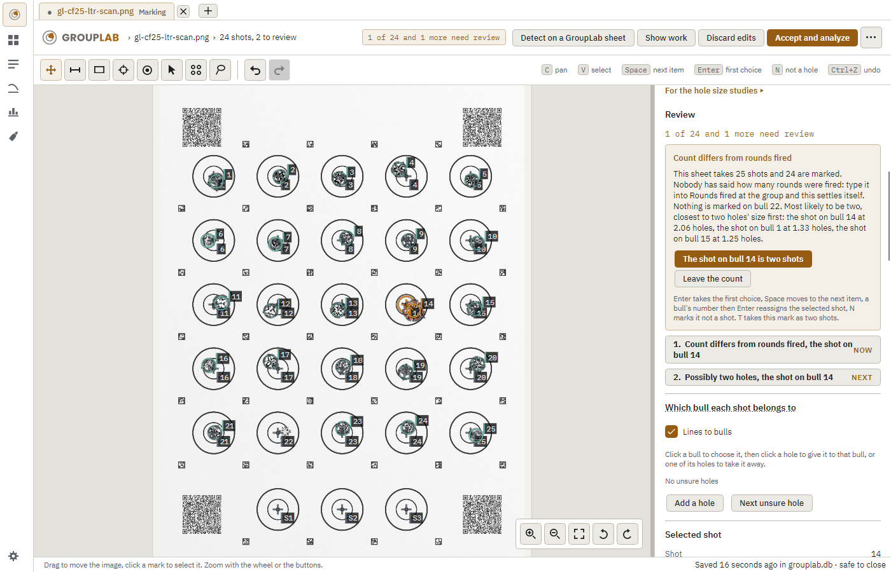

The pill in the header counts the marks that need you. The review queue in the side panel lists each one with the choices that settle it. The items are:
- **Contested assignment:** a hole that could belong to either of two bulls, or one that the matching gave to a bull other than its nearest.
- **Possibly two holes:** a mark about the size of two holes.
- **Possibly one hole:** two marks closer than half a hole's width, probably one hole marked twice. **One shot** leaves one mark at the middle of the two; **Two shots** keeps both.
- **Hole read with what is beside it:** a mark at least twice as wide as a hole, usually a hole joined to the printed rings in a photograph taken off square. GroupLab places the shot on the part the size of one hole; check it sits on the hole, or move it.
- **Two shots on one bull.**
- **No bull.**
- **Count differs from rounds fired:** raised when you have said how many rounds you fired.
- **Refused candidate:** something the detector saw and did not take as a hole.
- **Bulls with nothing on them:** when you have said how many rounds you fired and GroupLab finds fewer, it names the bulls that are empty. **A shortfall is never allowed to pass as a clean result.**

### Change an answer

An answered item stays in the queue, marked DONE. Click it and its card says what you answered, with **Ask again**, which opens the question once more, and its choices, which change the answer straight away. On the phone, answered marks fold up under one line, **Show the answered marks**, each with **Ask again**. Undo takes either back.

### Name the caliber if you know it

It sets the smallest hole GroupLab will accept, which matters most for small calibers, and it gives you the edge-to-edge figure. On one of the test scans it is the difference between nineteen holes found and twenty-four; on another it is the difference between missing the shot at the edge of the scan and finding it. A .22 hole in paper is much smaller than the bullet that made it, and without the caliber the detector has only the shape of a mark to go on.

### Holes between bulls, and marks off the grid

A hole that lands between two bulls, or beside the grid rather than on it, is kept, counted and offered to you. It is never dropped for being in the wrong place. Where GroupLab is not sure which bull a hole belongs to, it says so and the figures built on that assignment carry the doubt with them until you have settled it: **a figure that rests on a guess is marked as resting on a guess.**

The queue works from the keyboard:
- **Space** goes to the next item.
- **Enter** takes its first choice.
- **Type a bull's number and press Enter** to give the shot to that bull.
- **T** takes a flagged mark as the two shots the detector says it is.
- **N** marks the selected mark as not a shot.

The tools have keys too:
- C or P pan, V select, I impact, A aim, L length, R rectangle, B place bulls and O lasso shots onto a bull;
- the square brackets turn the view;
- Delete removes the selected mark, or with Place bulls the bull chosen;
- the arrow keys nudge the selected mark, or move the view (see From the keyboard, under the analysis);
- Ctrl+N starts a new target, clearing this one with a way back from the note it shows, and Ctrl+V pastes a picture, Command N and
  Command V on a Mac;
- Ctrl+Z and Ctrl+Y undo and redo, and on a Mac Command Z and Shift Command Z. The undo button's tooltip says what it will undo.

To move around the sheet, a mouse wheel zooms about the pointer, and a touchpad's two finger drag moves the sheet. A pinch zooms, on a touchpad or a touch screen, and so does Ctrl, or Command on a Mac, with any scroll. On a Mac any plain scroll moves the sheet, as it does in other Mac applications.

In the side panel you also set:
- the caliber, as the bullet's diameter;
- the shot distance;
- the rifle and barrel, in one list with the barrel that is on now first, and the load, from your records;
- the rounds fired, as a check on the count;
- at the bottom, in a closed fold, **For the hole size studies**: the paper and the backing. They are recorded only and change no detection, so hole sizes can be compared later by paper and backing. **Remember these for my next sheet** is on unless you turn it off.

When the marks are right, Accept and analyze. Anything still open stays open: the analysis names it, and the sheet crumb goes back to it.

## 5. Read the analysis

If these figures are new to you, you can learn them from the beginning in [Statistics for shooters](STATISTICS-PRIMER.md).

The analysis has three columns:
- **On the left:** the sheet small, drawn from its definition with every shot on it, then the load and the shot table. A click on a bull in the small sheet selects the shots given to that bull, and a click on a shot wide of every bull selects that shot. For a pooled set, every sheet's shots are drawn over the one sheet, each sheet in its own color, and a click on a bull selects its shot from every sheet. A shot picked anywhere, on the plot, the picture or a row of the table, is ringed with a cross through it in all three places, in magenta, a color nothing else in GroupLab uses, edged in black on the dark theme and white on the light, over every other mark, and its row has an amber bar, a brighter fill and bold numbers; the table scrolls to it.
- **In the center:** the composite plot. Every scoring shot is drawn on one bull, each from its own bull's center, over the bull's rings drawn as wide gray bands. Green lines cross at the group's center and blue lines at where you aimed, both across the whole plot; the CEP circles are green, CEP 50 dotted, CEP 90 solid, CEP 95 dashed and CEP 99 in dashes and dots; the extreme spread is a red dashed line between the two shots furthest apart. Toggles beside the plot turn CEP 50, CEP 90, CEP 95, CEP 99 and the extreme spread on and off, and GroupLab remembers them; CEP 95 and CEP 99 start off. CEP 99 on also lists it with the figures, with its range, and where your shots are too few to reach that far out, fewer than one expected outside the circle, it says the circle is the model's guess rather than something the shots show. Under Advanced, **A circle for any percent** takes a percent from 1 to 99.9, draws it in long dashes, lists it, and is remembered. **Group** and **Whole target** beside them frame the group alone or the entire bull with the group inside it, also remembered. The mouse wheel or a pinch zooms, dragging empty paper moves the view, and a double click returns to the fitted view. An excluded shot is drawn hollow and is never removed.
- **On the right:** the zero correction, the figures and the two judgment cards.

### Tap a number to switch units

Tap an angle to switch that number between mil and MOA, a size on the paper to switch it between
inches and centimeters, and a distance to switch it between yards and meters. Only the number you tap changes, and GroupLab remembers
the unit for that figure, so mean radius in MOA stays in MOA the next time while extreme spread can stay in mil; figures you never tap
follow the scope unit ([Mil or MOA](#mil-or-moa)). Right-click a number, or press and hold it on the phone, to choose any unit it can take, SMOA and millimeters
included. A figure's name still explains it when you tap it; only the number switches.

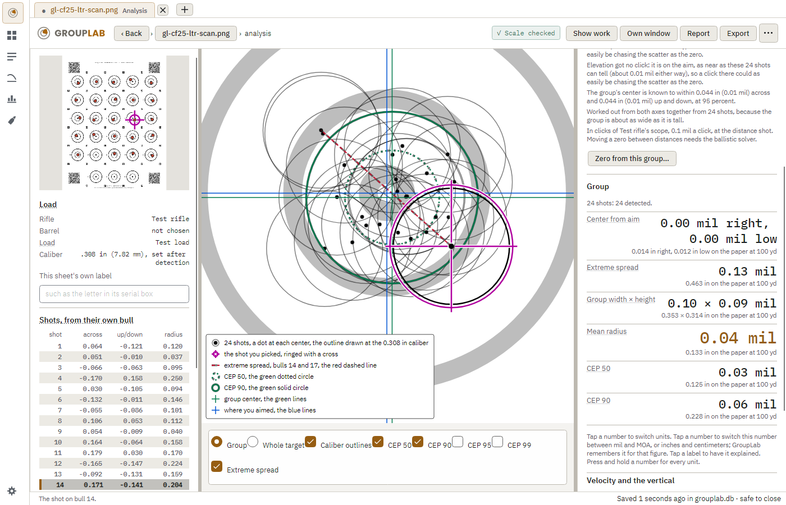

### From the keyboard

Tab and Shift+Tab move through every button, box and list, Space or Enter presses what has the focus, and a ring shows where the focus
is. Choosing a shot in the shot table with Space, Enter or a click leaves the focus on its row, so the next Tab carries on from there.
The arrow keys:
- **The shot table:** Up and Down choose the shot before and after, as a click would, and the picture and the panels follow. Home and
  End choose the first and the last, and Esc clears the choice. In a pooled set, Left and Right go to the same bull on the sheet before
  and after, from 1.6 to 2.6, since a bull holds one shot from each sheet.
- **The bar down the left:** Up and Down move between its buttons, and Space or Enter opens one.
- **The tabs, the bar along the top and other rows of buttons:** Left and Right move between the buttons.
- **The marking picture:** with a hole selected, the arrows nudge it one pixel of the picture, ten with Shift held, in the direction
  they point on the screen however the view is turned, and a run of presses is one step Undo takes back. With nothing selected they
  move the view. They act only while the picture has the focus: click it, or Tab to it.

The arrows never act in a text box or a number box, radio buttons and drop downs keep their own arrows, and moving the focus never
presses a button. The marking screen's own keys are listed in the line above the picture.

### Click a hole to edit it

A small editor opens beside it, not a dialog over the page. From it you can move the hole with the arrow keys, a hundredth of an inch a press and a tenth with Shift held; give it to another bull, either from the list or by clicking a bull on the sheet; set its size by hand where the detector read it wrong; leave a note on it; and mark it:
- **Sighter**, which sets it aside from the group, as a shot on a sighter bull already is;
- **Flyer**, which calls it out on the sheet and in the list and **changes no figure**;
- **Leave out of the figures**, which does change them and asks no reason (a reason stored earlier is shown, read only, and still printed in reports): every figure, the report and the saved session then leave the shot out, it stays on the sheet drawn hollow, and each figure's detail gives the figure again with every shot;
- **Delete, not a hole**, for a staple, a tear or a pen mark. The mark stays at the end of the Shots list with **It is a hole**, and Undo works. **Remove the mark** deletes it fully.

In the Shots list each shot is a short row (across, up and down, distance from its own bull). Click a row, or the shot on the sheet, to open it in place: the bull (nearest first), its place in the firing order, **Counted**, and where it came from (Found by GroupLab, moved by you, or added by you). The firing order is what **In the order fired** uses when there is no chronograph string.

A click on the sheet moves the side panel to what it changed and flashes that part twice: a hole opens its row under Shots, a bull goes to **Which bull each shot belongs to**, and Shift or Command on a bull goes to **Loads on this sheet**. The line under the picture says in a sentence what the click did. Where your computer is set to reduce motion, the part is tinted for a moment instead of flashing.

Flyer and "leave out" are deliberately two different things. Pointing at a shot and dropping it from the group are two different decisions, and GroupLab will not quietly make the second one for you because you made the first.

Every edit shows a small message at the bottom of the screen saying what changed, with **Undo** on it. Ctrl+Z and Ctrl+Y work everywhere, Command Z and Shift Command Z on a Mac, and the Undo on the message is the same undo.

### Words underlined with dots

Every word you may not know is underlined with dots, a figure's name or a word like sigma, MOA or bull, here and on the website. Hold the pointer over it, or tab to it, for two or three plain sentences saying what it means; click it or press Enter for the whole entry, with **More in the glossary**. For a figure the sentences say what it is good for and what the number of shots does to it. Every explanation says something about sample size, because every one of these figures depends on it, and the commonest mistake in group shooting is treating one five shot group as a measurement of a rifle.

### Six figures stay in view

Six figures stay in view: center from aim, extreme spread, group width by height, mean radius, and CEP 50 and 90. **With the shot distance set, each is an angle first,** in your scope's unit (the session's rifle's, or the one in Settings), and its size on the paper at that distance is beneath it in smaller type: an angle is what lets a group shot at 25 yards be compared with one shot at 100. Mil and MOA are the two a scope is marked in; SMOA, an inch at 100 yards, is there for those who think in it, so a 0.422 inch group at 25.4 yards reads 0.46 mil, 1.59 MOA or 1.66 SMOA. Without a distance the figures are sizes on the paper, and the panel says an angle needs the distance, with a button to set it. A setting puts the size on the paper first, for a shooter who only shoots one distance. **Every figure carries its interval,** the range the true value is likely to lie in, and the percentage it covers: hold the pointer over a figure to see it, with its angle at the distance shot. When you have excluded a shot, the tooltip also gives the figure without the exclusion, so an exclusion is never hidden.

**Advanced** holds everything else, closed until you open it: sigma, the strips across and up and down, the order the shots were fired in, the two cards below, the full CEP table, the sighters, and carrying the correction to another distance. GroupLab remembers whether you opened it. Where the rifle and load are known, Advanced also carries one line from Bryan Litz's Top Gun trend, the average group a rifle of that weight and load tends to shoot, labeled as a trend and not a limit (see Scope and mount).

### Velocity and the vertical

Velocity and the vertical, directly under the group's figures, says how much of the group's up-and-down spread comes from velocity
alone. It needs the session's chronograph readings (Ballistics, Chronograph), the shot distance and the load's BC; without one of them
it says which, with a button to it. The share is in amber with its range, at the confidence it states, then a meter from none to all of
it and two bars on one scale: the vertical spread measured on the shots, and the spread velocity alone would make at that distance by
the solver, flown in the conditions on the day. **Conditions on the day** (1), under the block once it has readings, holds them: closed,
one line says what is in use and where it came from; open, the temperature, the altitude (or **Use station pressure instead of
altitude**), the humidity and the shot angle, in your own units, with **Fill from Ballistics** for this rifle and load, **Standard day** to
clear them, a link to the rifle's page for its sight height and zero, and **Remember for my next sheet**, which offers them to your next
sheet of the same day. Each one left blank comes from Ballistics, when that screen has the session's rifle and load chosen, and then from
the standard day; a line compares velocity alone with these against a standard day. On the phone the card's **Conditions** row opens the
same as a sheet, with **Use these**. Nothing is ever filled from a location or a weather service. Where the range reaches all of it, it says the data cannot tell, and more readings and shots
narrow it. Where each reading was paired with its shot when the readings were accepted, a chart of height against velocity draws the
measured slope and the solver's, and a sentence says whether they agree, and if not, to check the distance, the BC or the order the
readings were paired in. Its why lists the readings' own spread, the solver's height per 10 fps, both vertical spreads, and that the
range errs wide, never narrow. It also says which conditions were used and where they came from, or that the standard day was assumed.
**Velocity band** (2), beside the plot's other toggles, draws the band velocity alone would make about the group center in amber, with the
measured spread as dotted lines; it starts on and is remembered. On the phone the same is a card above All figures, with Velocity band
under the plot; with no readings its **Import a file** and **Type them in** open a page to import your chronograph's file or type the readings. On the computer, with no readings the block says what readings add and offers **Import a file**, **Type them in** and a place to drop a Garmin Xero, LabRadar or CSV file. Type them in opens a box for the speeds in the order fired ("12 of 23 entered"), and **Match to shots** pairs them as Ballistics proposes. Ballistics' **Chronograph** section is still there: import a file from your chronograph (CSV, TXT
or Excel), or paste the velocities, then **Accept the mapping**.

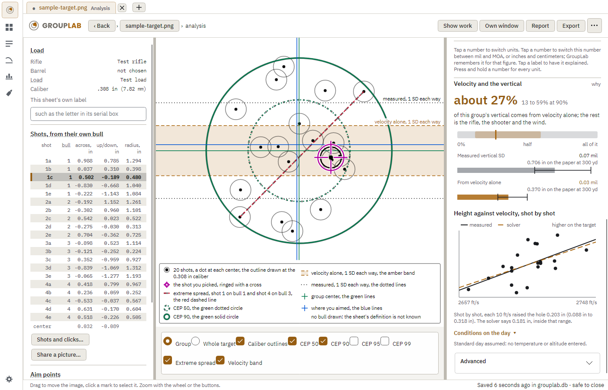
<!-- marks: Conditions on the day | Velocity band -->

**Back**, top left, returns to marking with every edit as you left it. The badge beside Show work reads **Scale checked** when the sheet's own markers set the scale; Show work has the detail. **Own window** moves the figures to a window of their own, for a second monitor, and closing that window puts them back.

**Under the shot table,** **Shots and clicks** opens every shot with its offset across and up from the aim point, the clicks that would
bring it onto the aim at your rifle's click value, and a **Counted** tick: untick it and the shot is left out of every figure, struck
through in the list and hollow on the plot, and still on the record. **Share a picture** puts a results box on the photograph: drag it
anywhere, drag its corner to resize it, and tick the lines it carries; the mean radius circle is drawn about the group's center, and a
label, the box's style and a crop around the group are beside it; **Save picture** writes it as a PNG. On a target GroupLab did not
print, **Aim points** lists each aim point in its own color with its own figures, and **+ Aim point** goes back to the sheet to place
another; the figures above pool them all. **Zero from this group,** under the zero correction, says where the group sits, the clicks
with the scope named and how well the center is known at this many shots, and opens Shots Needed to Zero or carries the offset into
Ballistics, whose dope then includes it at every range until you stop it.

### The zero correction

The zero correction gives the group center's offset across and up and down on the paper and in your scope's unit alone, mil or MOA, and the distance it is for. Where your rifle records its scope's click value, the line beneath spells it out in clicks with the click value stated: "Dial 2 clicks left and 8 clicks up, at 0.1 mil a click". The clicks are never guessed: a scope that adjusts in quarter minutes and one that adjusts in tenth mils are both common, and assuming either would send you the wrong way. A metric and imperial toggle on the page switches the length unit between inches and centimeters, and changes nothing that is stored.

It says what to dial when the group's center is far enough from the aim to be told from chance. An axis that is not is named and left
alone, with why: "Dial 1 click left, at 0.1 mil a click. Elevation: leave it. 0.08 mil low is within what these 20 shots can tell apart
(about 0.11 mil either way)." When neither axis is, it says so for each and how many shots would settle it, and **Shots Needed to Zero**
works the number out. Dialing an offset nobody can distinguish from zero only chases noise. If you would rather have both clicks always,
Settings, **Zero correction**, has **When an axis is inside the scatter**: **Say leave it, and why** (the default) or **Give the clicks
anyway**, which rounds both axes to whole clicks and marks the uncertain one ("The up click is within the scatter; more shots would tell
whether it is needed"). An axis that rounds to no click says "no click" either way. The same setting is on the phone.

### The two cards

The two cards, in Advanced:
- **Shape** says whether the group is round, as far as its shots can tell. It also says whether it strings vertically, and what that test could have detected. A test on few shots misses most real stringing, so "no evidence" is not evidence of none.
- **Worst shot** says whether the shot furthest out is further than groups of that size usually put their worst. Even when it is, that makes it worth a look, not a flyer. Whether it was called or pulled is yours to say.

### What each "why" says, in plain words

- **Zero correction:** first why an axis got no click (or got one anyway); then how well the center is known on each axis, as "0.225 in (0.06 mil)"; what rounding to whole clicks leaves; how it was worked out, on each axis separately when the group is taller than it is wide, or both together when it is round; and that moving a zero between distances needs the ballistics screen.
- **CEP:** these circles come from the group's sigma, assuming the shots scatter evenly about the center.
- **Shape:** how often a truly round group would look this far from round, and the shape of the group's error ellipse.
- **Worst shot:** how far out the worst shot sits in the group's own mean radii, against where simulated round groups put theirs.
- **Decisions left unmade:** every figure here inherits the decisions still open.

### The full CEP table and the fitted ellipse

The full CEP table and the fitted ellipse are in Advanced, one more click away, and GroupLab remembers whether you opened them. The table gives the CEP at 50, 90, 95 and 99 percent three ways. The fit gives the center and the spread on each axis with their intervals, and the error ellipse.

### Fudd buster mode

Fudd buster mode, Unholy's idea and his name for it, sits beside it from twenty shots: a window that shows, with your own shots, the tightest and the widest three-shot groups among them, what averaging three-shot or five-shot groups would have said against every shot, and the zero chased five shots at a time, with how far each correction was from where the rifle shoots.

### Shots Needed to Zero

Shots Needed to Zero, suggested by Jylee, sits under them. From the group's spread and your scope's click value (the rifle's own, or chosen there) it says how many shots a zeroing group needs before its center, dialed to the nearest click, lands on the click closest to the true zero, or within one click of it, 90, 95 and 99 times in 100. Within one click usually takes a handful of shots; the closest click can take hundreds, because a true zero near the line between two clicks is hard to resolve. The spread measured on a few shots may be larger than it looks, so GroupLab allows for that by simulation, and shows its trials and seed; tick **Treat the measured sigma as exact** to work it out exactly instead.

**Export** writes the complete record as a GroupLab file, which names its photo by file name only, never the folders it sits in, so keep the two side by side: moved together they reopen anywhere, and where the photo is not beside it GroupLab says so and asks for it. Or it writes the shot coordinates as CSV for a spreadsheet: one row a shot, across and up from the point of aim in inches, MOA and mil, with the distance in the header, and each row naming its sheet, its session and the distance. **Import shots from a CSV,** in the menu, reads coordinates exported by other software: it starts from GroupLab's guesses at which column is across, which is up and down, the unit, which way is up, and whether the numbers are measured from the point of aim or from the group's own center, each to check and change, and a choice it cannot guess starts empty and says so; then it shows the analysis. Numbers measured from the group's center say nothing about where the aim was, so then there is no offset from aim. There is no image with an import, so the figures are the whole of it. **Choose several files at once** to put shots from many sheets together in one group, of any kind of sheet: they must have the same columns, as GroupLab's own exports do.

## 6. Sessions and the report

Accept and analyze saves the sheet as a session: the marking with every edit, its figures, a proof image and its own copy of the sheet. **After that, and after any change, it saves itself**: the status bar says when ("Saved 12 seconds ago in grouplab.db"), that it is safe to close, and the ··· menu at the top right has **Open the session's folder**. In Settings, under **Saving**, you can choose a **Save** button instead; then the bar says **Not saved yet** until you press it, and GroupLab asks before you leave or close a target with unsaved changes. Session records, in the rail, lists them newest first:
- filter them by rifle (1) and by load (2);
- open one back to its analysis, which needs no image;
- delete one (3), after GroupLab asks.

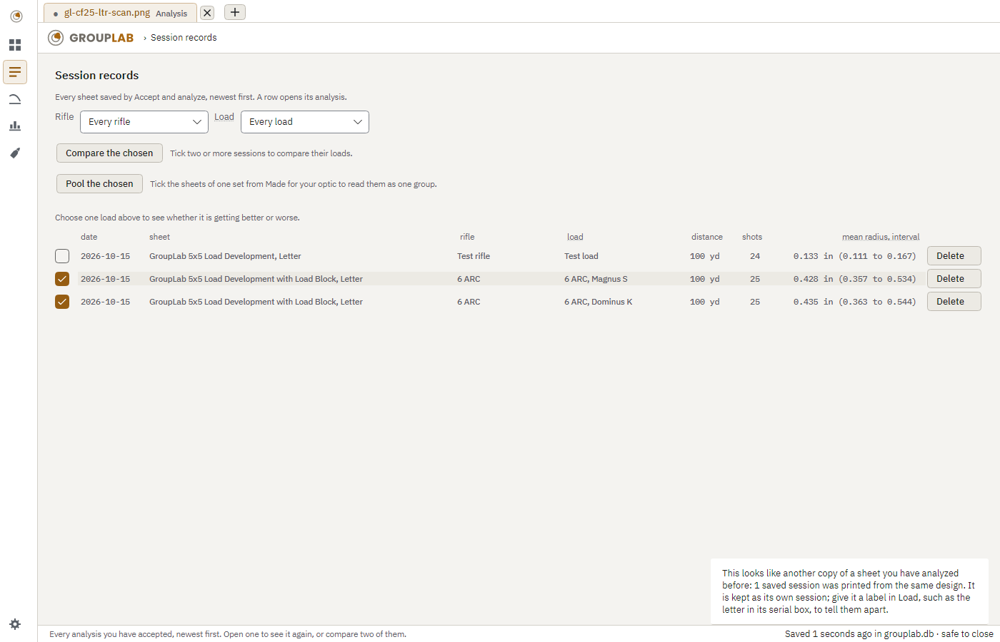
<!-- marks: Rifle | Load | Delete -->

The analysis's **Report** button saves the session as a PDF, the full report or one page. **Full report:**
- **Page 1:** the particulars, the plot, the figures with their intervals, the zero correction and the cards.
- **Page 2:** the shot table, the exclusions (with their reasons where one is stored), any decisions left unmade, the registration and every "why".

Every line on it is one the screen shows.

### One-page report

One-page report is one dated page, on Letter or on A4 as your region prints: the picture, a plot centered on the group and scaled to
fill it with its grid stated, the figures table, the load and equipment, and a sentence saying how sure the mean radius is at this many
shots. The phone makes the same page.

## 7. Comparing loads

Tick two or more sessions in Session records and press Compare the chosen. They appear side by side on the comparison screen, the rail's chart. Each has its plot and its figures with intervals, and below them are the tests with their verdicts.

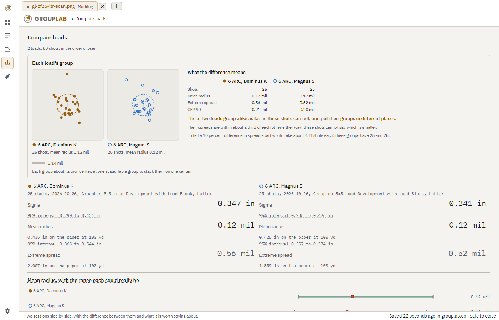

### The loads are never ranked by their figures alone

When the intervals overlap, the screen says the data do not separate the loads. The sentence under each chart and the verdict are one decision, so they never disagree. Every test also says what it could have detected, and the table at the foot gives the shots per load it takes to resolve a smaller difference. Sessions shot at different distances are compared as angles, and the screen says so.

### Each session is named by what tells it apart

Each session is named by what tells it apart: its load where you gave one, then its date where two would read the same, then its time, with the sheet's name beneath. Two sessions shot on one sheet on one day read "2026-09-29, 04:40" and "2026-09-29, 05:01", not the sheet's name twice.

## 8. The zero correction at another distance, and the dope table

The ballistics screen keeps what the solver needs on your rifle and load records:
- the sight height and zero distance;
- the muzzle velocity and its standard deviation;
- the BC, its drag model and its reference atmosphere;
- the bullet's weight, and for spin drift its length, its diameter and the twist.

All of it is optional. A record without what the solver needs says which field is missing.

### Chronograph readings

Under the trajectory, **Chronograph** takes a session's velocities: type or paste them and press **Read the
list**, or press **Import a file** for a Garmin Xero export from ShotView (a CSV, or an Excel file in which each sheet is a string:
choose the string by its name), a CSV from a spreadsheet (the column of velocities found by its header, or chosen, in ft/s or m/s), a
LabRadar report, or a BulletSeeker export. The Xero reader reads every one of Alan's exports since May 2024; the LabRadar and
BulletSeeker readers are Experimental. A shot deleted on the chronograph stays missing from the numbering, a shot the Xero left out of
its own figures is kept and said, and where a file's own average, SD or spread differs from its shots GroupLab says so. A place name or
coordinates in an older file are never read. A file larger than 10 MB, a workbook that would unpack to far more than any export, or a
damaged file is refused with a sentence saying why, and a formula in a cell is never worked out. GroupLab then proposes what each reading goes with, a row per reading in the order fired:
its number, its speed in the string's own unit, its time where the file has one, and its mark, **Shot 2** in teal, one that needs a
look, such as **Shot 5, left out in ShotView** or **Shot 1, clean bore**, in amber, and **Not this group** plain; a pause that split the
string shows between the rows, such as **6 minute pause**. Above the rows a card says what is proposed and why: a typed list pairs in
order, and a file that numbers and times its shots, as the Xero's does, proposes more and says so. Where the chronograph's pauses split
the string into runs and only one stretch of them has as many shots as the group, the rest are another group's; then a shot the Xero
left out of its own figures is left out, then one marked clean bore is this group's clean bore shot, while there are more readings than
shots; and where the numbering skips a deleted shot, the shot fired in that place goes without a reading. To change a mark, click it on
the computer, which opens the choices under its row, or tap it on the phone, which opens a sheet from the bottom; both offer the same
four, **Not this group** (1), **A shot of this group** (2) (then the shots to choose from), **This group, clean bore** (3) and **Leave it out**.
Changing one mark never changes another without saying so: choosing a shot another reading has swaps the two and says so, and taking a
reading off its shot says that shot now has no reading. Press **Accept the mapping** on the computer, or **Keep this pairing** on the
phone; **Leave unpaired** keeps the readings with no shot beside any of them. The readings' own spread becomes the load's velocity SD,
and Velocity and the vertical uses them. On the phone the same is under Velocity and the vertical's **Import a file** and **Type them in**.

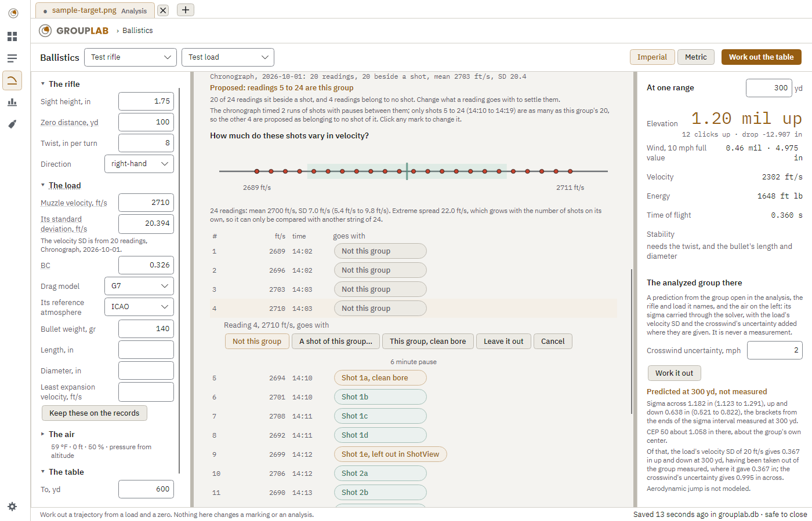
<!-- marks: Not this group | A shot of this group… | This group, clean bore -->

### How the screen is laid out

Three columns, like the analysis:
- **Along the top:** the rifle and the load, Imperial or Metric, and the one amber button, **Work out the table** (1), which becomes
  **Work out the chance** in the hit probability view.
- **On the left:** the settings in sections that fold, **The rifle**, **The load**, **The air** and **The table**. A folded section
  says what it holds in one line, and GroupLab remembers which you left open. A field the solver still needs says "needed" beside it,
  and its section opens.
- **In the middle:** **Trajectory** (2), **Hit probability** (3) or **Point blank**, chosen at the top and remembered. The trajectory is a large chart of drop,
  wind drift, velocity or energy with the zero marked, and the dope table under it.
- **On the right, At one range:** the elevation for one range in large amber figures, with the clicks and the drop under it, then the
  wind, velocity, energy, time of flight and stability. Clicking a row of the table or a point on the chart sets the range, and its row
  is highlighted. Under it, the analyzed group carried to that range.

On a narrow window the side columns shrink, and below that the right column moves under the middle.

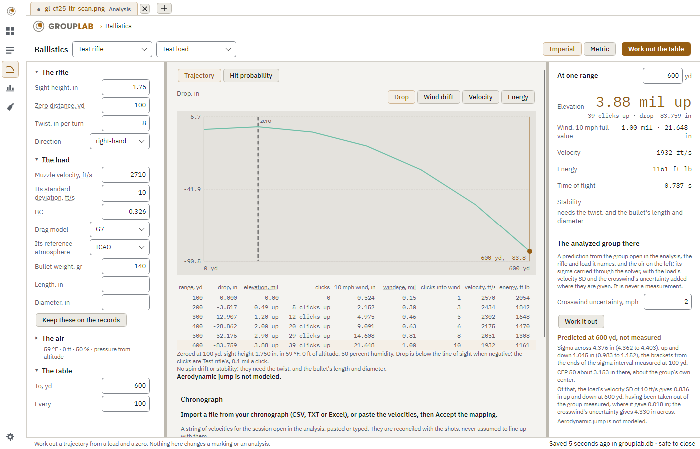
<!-- marks: Work out the table | BallisticViewTrajectory | BallisticViewHit -->

### The dope table

The dope table gives drop and the wind of a 10 mph crosswind at each range, in your units and your scope's clicks, with the velocity and energy there, in the air you enter. Aerodynamic jump is not modeled, and the table says so.

With a scope's travel entered on the rifle, a row past the elevation the scope has left says "out of elevation" and what to hold in the reticle instead. A sight scale factor other than 1.000 corrects the clicks, and they say so once. Both are described under Scope and mount, near the top of this guide.

### At another distance

On the analysis, the zero correction can be carried to a second distance, with its uncertainty carried with it. An offset that could not be told from zero is not carried.

The ballistics screen also carries the analyzed group to another distance, as a prediction and never a measurement. With neither a velocity
spread nor a crosswind uncertainty given, it is the group scaled by angle and nothing more.

### Hit probability

The middle's second view works out the chance of a hit on a circle, a rectangle or the official IPSC target A zone (1) at a distance. In
it the rifle, the load and the air fold to their one-line summaries, and the left holds **The target**, **What you are unsure of** and
**The shot and the simulation**. The target's distance and the range on the right are the same, so the hold shown and the chance are
for the same shot:
- **Rifle precision** fills itself from the group open in the analysis, or from every saved session of the chosen load pooled, or you type
  it. It is the per axis standard deviation of your shots as an angle, which is sigma, never a group size.
- The muzzle velocity's spread comes from the load, and the **zero error** starts at the uncertainty in your group's center.
- A **confidence preset** sets everything nobody can measure at once, from a known distance with the air measured to a guessed distance
  and a guessed wind. Under it each figure can be edited, with a bias for something you know is off, such as a chronograph reading
  fast.
- The answer is a card that leads with the **first round**'s chance in large figures, then the **second round** fired after you saw
  where the first landed and dialed off its miss. Each comes with its interval, and the screen says whether the interval is mostly your
  precision's own uncertainty or the simulation's.
- **What costs the most** lists every error source by the hits it takes away, largest first with a bar for each, so you can tell whether
  to practice wind calls, work on the load or buy a rangefinder.
- For a string of several shots on one reading it gives the chance of at least one hit and the hits to expect.
- The simulated impacts are drawn over the target beside the card, and a curve shows the chance against distance with its interval as a
  band.

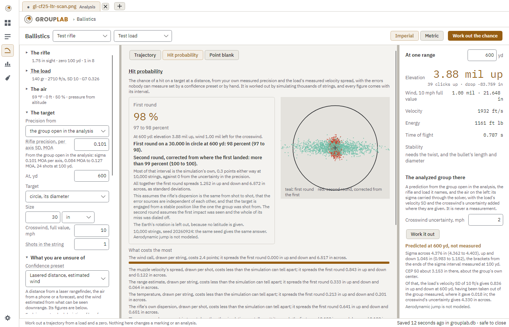
<!-- marks: Target shape -->

A wind call is drawn once for a whole string, never per shot, because every shot you fire on one reading shares its error. When the group
behind the precision is too small to say anything, the screen says so and how many shots would make it mean something. The same seed gives
the same answer.

The IPSC choice is the official IPSC target A zone, 15 by 32.5 cm, which replaces an outline GroupLab had drawn itself.

### Point blank range

The middle's third view, **Point blank**, answers one question: if I set my zero once, out to what distance can I hold dead on at
the animal or target I am shooting at, and be sure of hitting? It uses the rifle, the load and the air already chosen. On the phone it
is a fourth tab, **Point blank**, beside Dope, Trajectory and Hit chance.

**What you give it:**
- **Your mean radius**, in MOA, mil or inches at 100 yd. Type it, take it from the group open in the analysis, or, on the computer,
  take it from a saved session. On the phone you type it or carry the group in. Use a group shot from the position you will shoot from:
  a bench group is much tighter than one from sticks or a bipod, and a figure from the bench will promise more than the field gives.
- **Certainty**, the percent of your shots that should land in the zone. It starts at 90, with presets of 90, 95 and 99, and takes
  anything up to 99.9. 100 is refused, because no shot can be promised.
- **What you are shooting at**, a list drawn to scale. Game gives the heart and lung zone, and where published sources disagree the
  smaller figure is used: prairie dog, coyote, pronghorn, whitetail, mule deer, black bear, bighorn sheep, mountain goat, caribou, elk
  and moose. Five animals have no published size we could find (wild hog, European wild boar, impala, red stag and kudu); their rows say
  "Estimate, no published size found" and you can edit the size. Practical targets are the IPSC target A zone, the USPSA head A zone,
  the IDPA body -0 circle and two steel silhouettes (the steel shapes are a vendor's). Or enter your own circle or rectangle.
- **An energy floor**, a rule of thumb you can change or leave blank: 1000 ft lb for deer-sized game and 1500 for elk-sized.
- The load's **Least expansion velocity**, a field on the load that comes from the bullet's maker. Blank says it is not entered.
- **Crosswind**, 10 mph to start, and the **shot angle**.

**Three ways to set the zero**, chosen by the switch at the top:
- **Longest dead-on hold:** the zero that keeps the chosen share of shots in the zone out to the farthest distance.
- **My most likely distance:** you say how far you expect to shoot. The group is centered on the zone there, and GroupLab shows the
  dead-on band around that distance and the holds past it.
- **A window of distances:** the zero with the best worst-case chance across the window. When even the best zero falls below your
  certainty, it says so, for example "No single zero keeps 9 in 10 across" the window, and gives the best zero, its worst point and what
  would help: a narrower window, a larger zone or a hold over.

The rifle's present zero and the band it gives are always shown beside whichever you choose. When the zero chosen needs more elevation than the scope has above your present zero, the view says so, and the clicks it gives are corrected by the rifle's sight scale factor (see Scope and mount).

**The answer** leads with the band in large figures, such as "Dead on 0 to 263 yd", and the sentence that says what certainty it holds.
Under it:
- how to set it, in words and clicks, such as "Zero 2.6 in high at 100 yd: 0.72 mil, 7 clicks up from your 100 yd zero";
- what ends the band, named: the certainty, the energy floor or the least expansion velocity, whichever comes first;
- the wind's drift at the far end, with a warning when it is more than half the width of the zone;
- the rifle's present zero, and the classic figure for reference (the distances over which the path itself stays inside the zone,
  which says nothing about where your shots land);
- for hunting targets, a line to check your local law;
- "Not counted: the wind (shown separately), a moving animal, and a misjudged distance."

A picture of the path shows the zone, with the dead-on stretch shaded.

**Print a card.** A 50 by 30 mm label with the rifle, the bullet, its velocity and ballistic coefficient, the dead-on distances, the zone
and certainty, the zero at 100 yd with its clicks, and the date. On the computer it is saved as a 203 dpi picture and as a PDF, for the
M220's app or any printer at 100 percent. On the phone it is shared, or printed straight to the M220 over Bluetooth when 50 by 30 mm
labels are loaded.

**Keep this zero on the rifle.** Sets the rifle's zero distance to where the chosen path crosses the line of sight again. The old zero is
kept, and **Put back the 100 yd zero** restores it. Every ballistics figure then follows the new zero.

**From the keyboard.** The three zero buttons and the list of targets are reached with Tab and chosen with Space or Enter. The
certainty presets work the same way.

**Where the sizes come from:**
- americanhunter.org, 2017, the article on maximum point blank range;
- Ron Spomer, understanding maximum point blank range;
- randywakeman.com, maximum point blank range, with Chuck Hawks's table;
- HuntWise, on bears;
- Wikipedia, point-blank range;
- IPSC rules, January 2024, appendix B2;
- USPSA rules, appendix B1.

## 9. Keeping GroupLab up to date

GroupLab checks for a new build when it starts and about once a day after that, and tells you in a bar across the top of the window when one is ready. Nothing is downloaded until you ask for it and nothing is installed without you pressing the button.

When you do, GroupLab downloads the installer, checks it against the SHA-256 the release states, and hands it to Windows. The installer is per-user: it never asks for an administrator, it installs under your own account, and it closes and reopens GroupLab around the update. After it comes back, the same bar tells you which version you are now on.

If an update ever fails, the build you had is still installed and still works. Nothing is removed until the new one is in place.

### Android updates itself from an APK

GroupLab on Android updates itself when installed from an APK, GroupLab Dev or the plain APK. A plain APK from before nightly 177 has no updater, so install one newer plain APK by hand once; it keeps itself current after that. The build looks for a newer nightly when it starts and about
every six hours, downloads it on Wi-Fi in the background, and checks both its SHA-256 and that it is signed with the same key as the copy
you have before installing it. The first time, it asks for Android's "Install unknown apps" permission and opens that page for you, and
Android asks you to confirm the first update; Google Play Protect asks to scan the new copy first, on the first install and on updates, as
it does any app from outside the Play Store: it is Google's own check, takes a few seconds, and is expected. After that it installs by itself when you leave GroupLab, never while the camera is open, a
sheet is being read or a change is unsaved, and your sessions and settings stay. Settings, About shows the version you have, the newest
one, **Update now**, and **Install updates automatically**, which you can turn off. The copy from Google Play has none of this: Google Play
updates it.

## 10. Comparing several sheets at once

### The sheets of a set pool into one group

When Made for your optic needs several sheets for your shots, each sheet's codes say which of the
set it is. Print the set, shoot it, open each scan or photograph and choose **Accept and analyze** on each, in any order; then in **Session
records** tick them and choose **Pool the chosen**. GroupLab says which sheets of the set are still missing and how many shots it has of the
bulls the set holds, and opens the pooled set on the analysis screen in a tab of its own (1): every shot on one plot, measured from its own
bull, every figure a sheet has, and the Shots list naming each shot by sheet and bull (2.5 is bull 5 on sheet 2). Each sheet's shots are
in their own shade; tap a sheet in the plot's key to show its shots alone. A sheet read twice counts once.

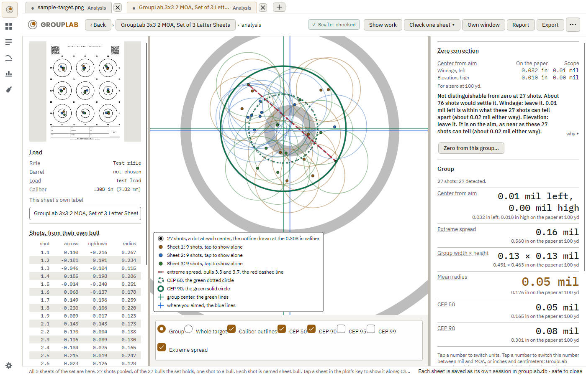
<!-- marks: GroupLab 3x3 2 MOA, Set of 3 Letter Sheets, 3 sheets, Analysis -->

### Quicker: drop them together

Drag the scans or photographs of a set onto the window at once (or paste them together) and GroupLab reads
each one's codes first. When they are sheets of one set they open in **one tab**, named for the set ("GroupLab 3x3 2 MOA, Set of 3 Letter
Sheets, 3 sheets"); the sheets are read one after another while the status line says "Reading sheet 2 of 3", each is saved as its own
session record, and the tab shows the pooled set, with no question asked. **Check one sheet** on its analysis screen opens one sheet alone
to check its holes and scale and fix them as on any sheet; **Back to the set** shows the pool again with the change in it. A sheet still
missing is named, and dropping it onto the set's tab later adds it. Two different pictures of the same sheet are both left out until you
say which one counts; the same picture twice counts once. Pictures of two sets open a tab for each set, and a picture of anything else a
tab of its own. Pictures with no codes to read, a target from a shop or a plain photograph, are asked about once: **Pool them in one tab**
or **One tab each**; pooled, each still needs its own scale. A picture dropped onto a tab that already holds a target never replaces it:
it opens in a new tab beside it. On the phone, choose the sheets of a set together, or share them into GroupLab together, and the set's
checklist opens with the pooled group showing; the checklist also has **See the pooled group**.

Reading other sheets of one load as one group is **not built yet**. It is not a matter of adding the numbers up: separate sheets shot at one
aim point each have their own center, and what a pooled figure means depends on which center you measure from, which is still being decided.
Meanwhile **Compare loads** puts the sessions of two or more loads side by side, each with its own figures and intervals, and Bryan Litz's Top Gun trend for each load where the rifle's weight is known.

## 11. If something goes wrong

### Report a problem

Report a problem is in the settings, under Diagnostics. It opens a window that lists what the report holds before anything is written: GroupLab's log of this run and the one before, the version of GroupLab, the operating system and the display, and, if you write them, a description of up to 500 characters and a way to reach you. It holds no photographs and no location. **Save only** writes the report as a zip where you choose, and **Show me the file** opens the folder it went to. Nothing is sent unless you press **Send**, which appears only when the project's report address is open; otherwise the window tells you to send the zip by opening an issue on GitHub or by email, with the build line from the settings page.

GroupLab can also send error reports by itself, once you say so: the first time it can, and in Settings under **Error reports**, you choose automatically, ask each time, or never. A report holds the version, the system, the error and the names of the last things done, never anything you typed, and never a photograph, file name or location. On the computer a report can also carry GroupLab's log from this run and the last, with anything you typed replaced by its length, and that is asked about first; on the phones it stays off for now. Crash records are written to your own machine whether or not you ever send them. They name the version, the build train and the line it happened on, and they never contain a photograph, a location or anything read out of one.

### Send to GroupLab and Send diagnostics, on the phone

Settings, About, **Send to GroupLab** sends the two newest logs and any crash
record straight to GroupLab's maker by the same route as an error report, with a note if you write one, and says the reference it was
given; nothing about where you are, no picture, no file names, and no name you typed goes with it. **Send diagnostics** puts GroupLab's newest logs, any crash records and the pictures
kept of a sitting into one file and opens the share sheet, so you choose where it goes: AirDrop, Files, OneDrive, email or a message.
GroupLab sends nothing itself. The logs hold no location and no file names, and a kept picture has had its metadata taken out.

### Sending in targets

The page at `grouplab.org/targets/` takes scans and photographs of targets that help GroupLab get better at reading them. You choose how they may be used: testing only, kept by the project and never published, or may be published in GroupLab's public test data and research. GroupLab can also send a target itself once you have analyzed it, with the holes it found and the ones you corrected, and it asks first every time unless you say otherwise in Settings.

## 12. Settings

The gear opens the settings:
- **Units:** first the **Scope unit: mil / MOA**, with a line saying what it changes (see [Mil or MOA](#mil-or-moa)), then lengths and distances, each chosen on its own. They change only how figures are shown. Beneath them, a box puts a group's size on the paper before its angle. The phone's Settings starts with the same Units.
- **Theme:** dark, light, high contrast, or follow the system.
- **Your data:** **Export all my data** (1) writes one file, ending `.grouplab`, holding every session with GroupLab's own picture of the sheet and its marks, your rifles, barrels and loads, your designed sheets, and your printers and units; **Import data** (2) reads one on any GroupLab, on the computer or the phone. Importing never overwrites or duplicates anything: before anything is written it says what it would add and lists anything here that differs from the file, which is kept as it is here, and you can cancel. The file follows GroupLab's rule for photographs (no location, no metadata, not where the original photograph is kept) and stays with you. On the phone, Export all my data opens the share sheet, so the file can be saved to Files or sent to your computer, and a `.grouplab` file opened with GroupLab from another app offers to import it.
- **Layout:** every split between panes, on the marking and analysis screens, Targets (the list, the sheet's column and the preview), Equipment and Ballistics, can be dragged by its grip, and GroupLab remembers where you left each one. **Reset layout** puts every pane back to its default size at once. On a tablet or an unfolded phone held sideways, the line between the sheet and the numbers on a result is dragged the same way, and the phone's Settings has the same Reset layout.
- **Sharing:** the three things GroupLab may send, in the order the first run screen asks them. Each shows its choice and one short line; **More** opens the full explanation of what it sends, and stays open once you have opened it. **What GroupLab sends** (3), above them, opens the page on grouplab.org that says exactly what leaves your device. **Sending targets:** send every target you analyze to the project, ask each time, or never, and which consent goes with them; on the computer also **Send everything I open**, which sends every picture you open, read or not, and stays off on the phones for now. **Error reports:** send them automatically, ask each time, or never, and what a report holds. **Hardware survey:** take part or not, what a report holds, the benchmark, and a button that gives this copy of GroupLab a new random number. The benchmark runs only when you start it, from **Run the benchmark now**; it shows how far it has got, can be canceled, and says when it finished and what it found. Settings says when it last ran. On the first run screen, Yes to the survey asks whether to run the benchmark now or later.
- **Log:** how much the diagnostic log records, and where it is.
- **Problems:** a way to report a problem, and any crash records not yet dealt with.

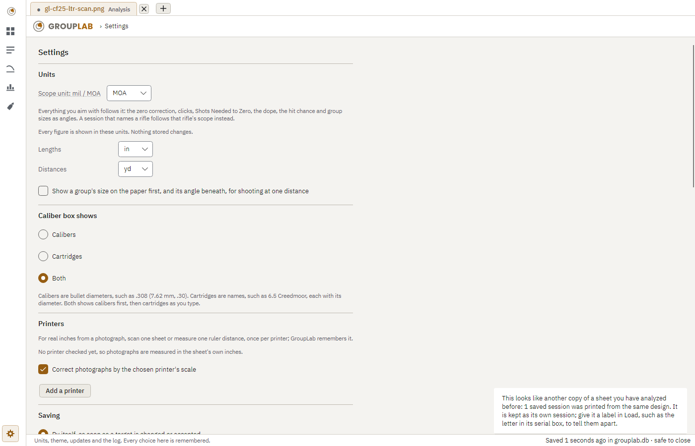

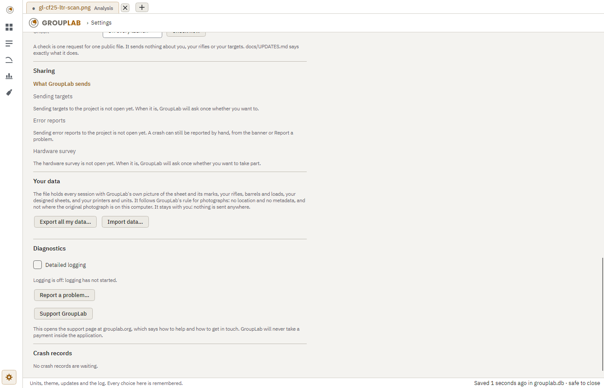
<!-- marks: Export all my data… | Import data… | What GroupLab sends -->

### Walk me through a demo

A guided tour of thirteen steps on a sample sheet of 25 shots that GroupLab makes itself, so it is nobody's target. It is offered once after the first run's questions, and any time from the row near the top of Settings or the header's ... menu; Settings also says **Carry on from step N of 13** when you left one part way. Each step outlines the real control and you can do it yourself or press **Next** and GroupLab does it. **End the tour** or Esc stops it at any step. It stops at Print, because printing is always your own press. Nothing the demo makes (its tab, its session, its picture) is kept unless you tick **Keep this demo in Sessions** on the last step.

**On the phone** (Android, iPhone and iPad) the tour is thirteen steps on the phone's own screens, with the same sample sheet: it opens it as a chosen picture from GroupLab's own files, never the camera, then shows the result, its figures, Fix holes, Shots, Zero from this group, Share a picture, Sessions, Ballistics, Targets and Settings. It is offered once after the first questions, and any time from Settings, **Guided demo**, **Walk me through a demo**, which also says **Carry on from step N of 13** when you left one part way. The card under or over each outlined control says the step's number, and scrolls when the phone's text is at its largest; a screen reader reads the card with its number. **Next** does the step for you; **End the tour**, or the phone's Back, stops it, and what it made is removed unless you tick **Keep this demo in Sessions** on the last step.

## 13. On the phone

GroupLab for Android runs on a phone or tablet with Android 10 or later and 4 GB of memory. **GroupLab Dev is the recommended download for
testing until GroupLab is on the Play Store**: from the [download page](https://grouplab.org/download/), it updates itself from every
nightly after the first install with no computer or adb, installs beside the Google Play test copy without replacing it, makes its logs easy
to send with a problem report, and gets fixes the same day. A nightly can occasionally break something, and Dev's data stays in Dev unless
you move it with Settings, **Export all my data** and **Import data**. The
plain APK and the Google Play internal test (if you are invited) are signed with different keys, so remove one before installing the other.
Android asks Google Play Protect to scan an app installed from outside the Play Store, on the first install and on updates: it is Google's
own check, takes a few seconds, and is expected. It uses the same engine as the computer, so the same picture gives the same numbers.

### The bar along the bottom

The bar along the bottom goes to the five places, **Capture**, **Sessions**, **Ballistics**, **Targets** and **Settings**, each an
icon over its name, the place you are in with its icon in an amber pill. GroupLab's text follows the phone's own text size setting, on
Android and on the iPhone (Larger Text), and changes while it is open when you change the setting. On the iPhone the largest
accessibility sizes stop at the size Android's largest reaches, so the screens still fit. When the text is so large that a name would not fit its share of the
bar, the bar shows the five icons alone, larger, and goes back to the names when the text is smaller again; your phone's screen reader
still reads each one out by name, and a long press shows it. A wider screen, such as a folding phone opened, keeps the names for longer.

### Capture

Capture is the first screen: the GroupLab mark, as wide as the screen allows without the page scrolling, one row with the caliber
and distance (**Change** types new ones; the distance is remembered from the last target, the caliber never is), **Take a picture**, **Choose a photo** and **Print a target** side by side, with **From another app** and **Paste a
picture** beneath, a **Getting started on your phone** card that opens this section, and grouplab.org and the version at the foot. For
every new target **Take a picture** or **Choose a photo** asks for the caliber in a sheet over the page, with the calibers you used
lately as one-tap choices and none chosen for you, so a caliber is never left over from the last target; then it goes straight on. The
distance may stay empty if you do not know it. **Take a picture**: the camera fills the screen with the instruction at the top, the
checks beneath it (focus, light, the tags and codes read) and a bar that forecasts the picture's quality. In **Guided** it takes the
picture by itself once everything holds; in **Manual** you press the shutter when you choose. Fill the frame with the sheet: GroupLab
says **Move back** only when some of the printing runs out of the picture, **Move closer** when the sheet's codes would be too small to
read, and **Hold steadier** only when a shake has smeared the picture. The level in the middle is a crosshair with a dot that drifts
toward the raised side like a bubble; when the phone is flat over a table, or upright and straight on to a sheet on its backer, the whole
crosshair turns green, and the word under it says which, **Looking down** or **Upright**. **Capture** and **Result**, above the page,
take you to the start of Capture or to the last result in one press, the one showing in the highlight color, and the camera has its own
**Result** button. While a picture
is read, the line under it names the step it is on, and **Cancel** stops it at once, at any step: Capture shows again with the picture
kept, to **Read it again**, **Choose which sheet it is** or **Forget it**. A reading that has not finished after a minute stops by itself,
says what it was trying to read, and offers the sheets to choose from; time with the screen locked does not count, and a reading carries
on when you come back to it. When a picture's square codes cannot be read, a sheet in the middle of the screen says so: what it got done,
the sheet it looks like, **Choose the sheet**, **Take it again**, **Try again, reading harder** once, which names each step and can be
canceled, and **Store-bought or hand-drawn** for a target GroupLab did not print,
which it remembers for that picture. A picture with no GroupLab marks at all asks **Which target is this?** instead, calmly, with **Mark it
by hand** first.

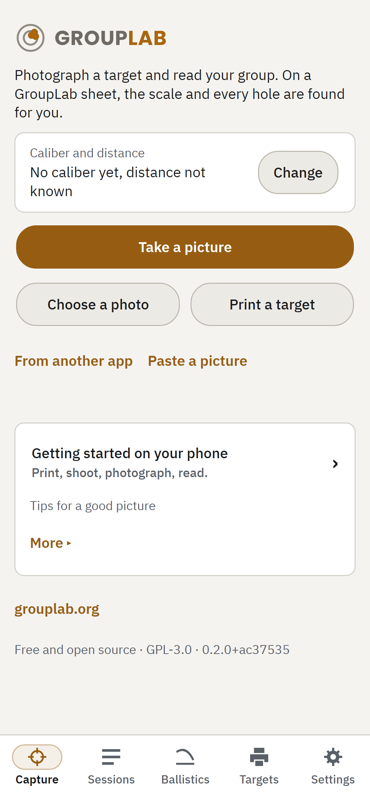

### Show diagnostics on the camera

Settings, About, **Show diagnostics on the camera** is off until you turn it on, on Android, iPhone
and iPad alike. With it on, a small block of numbers sits in the bottom corner of the camera: how many frames a second the camera is
judging and how long each takes, the instruction and the check holding it back (the angle, the focus or the light, with its value), the
tilt, and the torch's level. While a picture is read the same corner names the step being read, how long that step and the whole reading
have taken, and on both screens the memory GroupLab is using and how warm the phone says it is. It changes nothing about how a picture is
taken or read; it is there so that a screenshot shows somebody helping you exactly where GroupLab was. The log records the same memory
and warmth with each step of a reading and each change of instruction.

### A photograph from any photo app

**Choose a photo** opens Android's photo picker, which shows the photographs in your photo apps,
those kept only in the cloud included where Google Photos keeps them, and asks for no permission to your storage; a phone without one
offers the apps instead. **From another app** lists every app that offers pictures by name: Google Photos, Samsung Gallery, your phone
maker's own gallery, Drive, OneDrive, Dropbox and Files. A picture shared into GroupLab from any app, or opened or edited with it, is read
the same way. **Choose a photo** and **From another app** take several at once, and several chosen or shared together are read one after
another; when they are all sheets of one set, the set's checklist opens with the pooled group showing. A photograph kept only in the cloud is
downloaded first, with a line saying which app it is coming from and a **Cancel**; the phone has to be online for that. GroupLab always
reads the whole photograph, and when an app hands over a smaller copy it says so before reading it and suggests another way.

### On iPhone and iPad

On iPhone and iPad (in a public beta through TestFlight): **Choose a photo** opens Photos, iCloud Photos included, with no
question about access, and **From another app** opens Files, which reaches iCloud Drive, Google Drive, OneDrive and Dropbox. iOS lets no
app open another app's library, so a Google Photos picture is **shared** into GroupLab: in Google Photos, Share, then GroupLab. The same
works from Photos and any other app, and **Open in GroupLab** from Files; the picture opens straight into analysis. A picture opened
from Files is read where it lies and left there. **GroupLab's own folder is in the Files app**, under On My iPad (or On My iPhone),
GroupLab: its log is in `logs`, and with **Keep every picture taken, on this device only** turned on in Settings, About, each picture of a
sitting is in `sitting` with what the camera read before it and how it was analyzed. That switch is off until you turn it on, and turning
it off deletes what was kept. On the camera the panel with the instruction sits above the preview rather than
over it, so the preview shows the whole of what the picture will hold.

### Updates on phones that stop apps in the background

GroupLab Dev looks for an update every time it opens, as well as about every six
hours, so an update is late at worst and never missed. Many phones stop that six-hourly check to save battery unless you allow it (the
names differ a little between versions):

- **Xiaomi, Redmi and POCO:** Settings, Apps, GroupLab Dev, Battery saver, No restrictions, and turn on Autostart.
- **OPPO, OnePlus and realme:** Settings, Apps, GroupLab Dev, Battery usage, Allow background activity.
- **vivo:** Settings, Battery, Background power consumption management, GroupLab Dev, Allow high background power consumption.
- **Honor:** Settings, Battery, App launch, GroupLab Dev, Manage manually, with Run in background on.
- **Huawei:** Settings, Battery, App launch, GroupLab Dev, Manage manually, with Run in background on.
- **Samsung:** Settings, Apps, GroupLab Dev, Battery, Unrestricted.
- **Motorola:** Settings, Apps, GroupLab Dev, App battery usage, Unrestricted.

### The picture check

Every picture, taken or chosen, gets a score from 0 to 100 on a red, amber and green bar, and numbered notes on the
picture itself: mostly what GroupLab corrected, sometimes what would help next time. Use it, or take it again.

### The result

The same figures as the computer: tap a figure's name for what it means and what your number of shots can tell, and tap a
number to switch its units. The picture of the sheet stands upright across the screen, with a ring on every hole and a line from each hole to its bull; **Lines to bulls** turns them off. Unsure lines are dashed in orange with a **?**. In Fix holes, **Next unsure hole** goes to the next one, tapping a bull chooses it, and tapping holes gives them to it or takes them away; **Done with bull C3** ends it. **Bull by bull** in the
figures does the same from a list, which is the way to check which bull each shot was given to. **Fix holes** opens it under a crosshair fixed in the middle: pinch to zoom and drag the picture until the crosshair is on a hole,
then **Add a hole here**, or **Remove this hole**, with **Undo** for each. After adding or moving a hole, GroupLab asks which bull it
was fired at, its own choice first. Each hole's circle is drawn at your bullet's diameter, so a
correct circle sits on the edge of its hole; with no caliber set, a line says that setting it makes the circles true size. **Move this
hole** leaves the circle where it was: drag the circle itself with your finger, the crosshair on its center, while a dashed ghost stays
where it started and a line says how far it has moved, and the picture scrolls when the circle nears an edge; **Put the hole here** drops
it and **Cancel** puts it back. On the computer, every hole's circle is the caliber's size too once one is set, with the size GroupLab
measured dashed beside it, and a hole dragged with the select tool leaves the same dashed ghost. **Done** takes
the changes back to the result, which measures again; leaving any other way asks whether to keep them. From the result: How you shot this sheet (the same two parts as the computer's Groups section, loads included), Shots Needed to Zero, Ballistics with the group carried in, sharing
the session, and sharing the shots as a CSV file. **Import shots from a CSV file,** under Sessions, shows the group as it will be read
and a card of GroupLab's guesses at what each column is, each line tapped to change, then **Import** and the result. Several files with the same columns can be chosen at once and are read as one group.

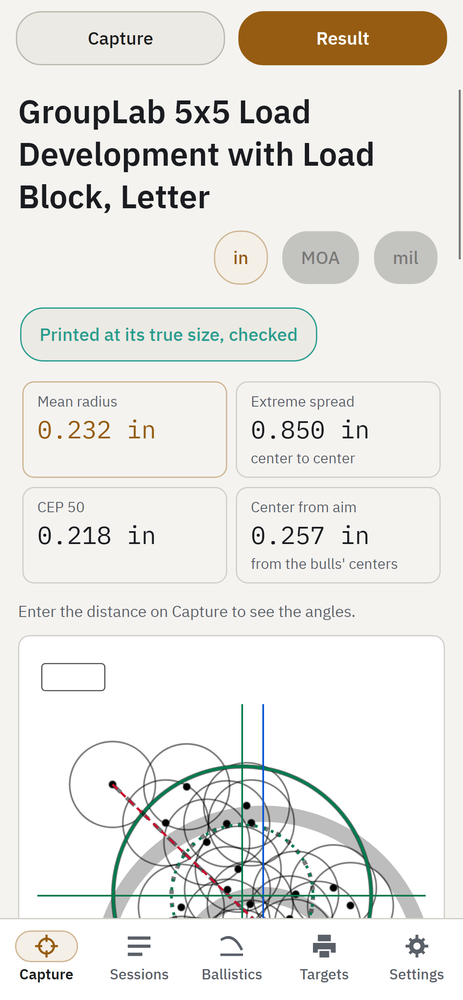

### Several targets open at once

Every target you read on Capture or open from Sessions stays open until you close it, each as you left
it, marks not yet saved included. The target's name at the top of its result, or above the step while you mark it by hand, opens **Open
targets**: a row for each, with a small picture of it, whether it is at **Analysis** or **Marking, not saved**, and a close button. Tap a
row to switch to it; **Open another target** goes to the start of Capture with the others kept. A result is saved in Sessions as you go,
so closing it loses nothing; marking by hand is saved only when it is finished, so closing a target with marks not saved asks first.
Opening a session that is already open switches to it. Up to eight are kept open; past that the oldest that would lose nothing is closed,
and it stays in Sessions.

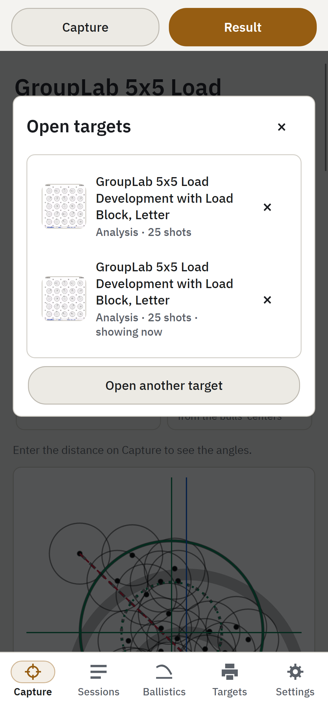

### Sessions, Ballistics and Targets

Sessions keeps every result, each named by its load, date and time; tick two or more to compare
loads, one figure at a time: each load's name on a line of its own, and its range and value beneath. Extreme spread has no range there,
so it says so and points you to mean radius. In **All figures**, a value too long to sit beside its name goes on the line under it. Ballistics is a
tab of its own: the dope, the trajectory and the chance of a hit. Targets prints a sheet through Android's print dialog or shares its
PDF, and prints the printer check page; on Android it also prints straight to a Phomemo M834 over Bluetooth at true size, without
the Phomemo app, with **Paper in the M834** for a roll (fed 15.5 mm further so the sheet clears the tear bar) or fanfold sheets; thermal roll paper
curls, so flatten a sheet (rolled the other way, or under a heavy book) before scanning it; at the range a clip or tape is enough; Settings, under **Printers**, checks your printer. On a large screen, such as the Tab S8 Ultra or
the Fold 7 opened, the result shows the sheet beside the numbers.

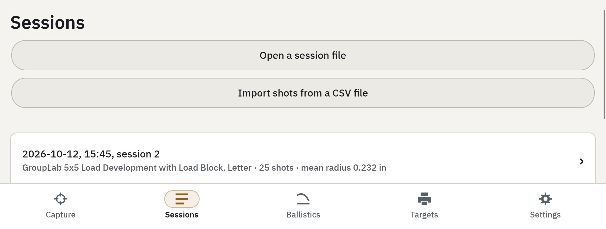

### A target GroupLab did not print

A target GroupLab did not print is marked by hand: choose **Mark it by hand** when GroupLab asks which target it is. The
picture moves under a crosshair that stays in the middle: set the two ends of a length you know and type it, set the aim point, then
**Add hole here** on each hole, with **Undo**. A mark under the crosshair can be removed; once the scale is known the crosshair's ring is
your bullet's size. In GroupLab Dev, the development build, **Find holes (Experimental)** at the holes proposes them, as on the computer:
each is a found hole to keep or remove there and to move in **Fix holes**, and one it is not sure of is ringed in amber and asked about on
the result. **Fudd buster mode**, under a result of twenty shots or more, is the same page as on the computer.
**Shots**, under a result, lists every shot with its offset across and up from the aim point and, with your rifle's click value, the
clicks to bring it onto the aim; its **Counted** switch leaves a shot out of every figure, struck through in the list and dashed on the
picture, and still on the record. **Zero from this group** says where the group sits, the clicks, whether that is worth dialing at
this many shots, and opens Shots Needed to Zero, or hands the offset to Ballistics, whose dope then includes it at every range.
On a target GroupLab did not print, **Aim points** gives each aim point a chip in its own color, its holes ringed in the same color:
tap a chip for that aim point's own figures, or **+ Aim point** to set another; the figures above pool them all.
**Share a picture**, under a result, puts a results box on the picture: drag it anywhere, pinch it or drag its corner to resize it, and
tap it to choose its lines. Chips turn the mean radius circle (drawn about the group's center) and a label on and off, and set the box's
style and the crop; then **Save to gallery**, which keeps it in Pictures, GroupLab, or **Share**. **Report**, under a result, shows the
one-page report itself, the PDF's own page, with **Share**, **Save on the phone** (Downloads, GroupLab) and **Print** above it.
Android's back button goes back one screen wherever you are, and every page uses the whole width of the screen.

